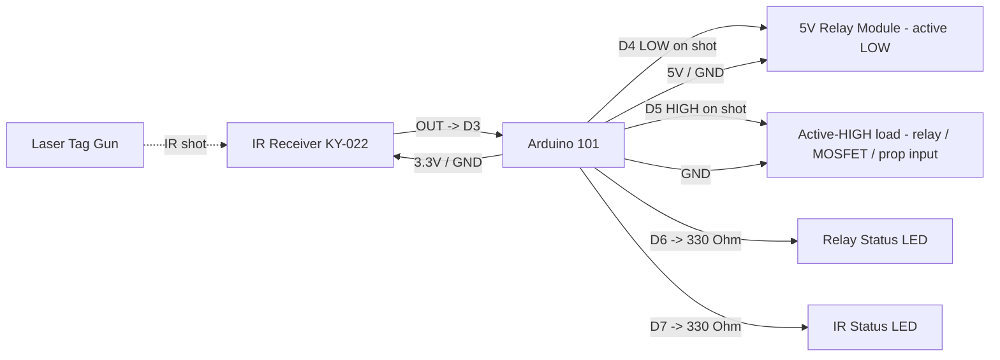

# Arduino 101 Laser Tag IR Dual Trigger Pinout

**Created:** 2026-10-21
**Last Updated:** 2026-10-21

Target sketch:

- `components/arduino101/Arduino101_LaserTagIRDualTrigger/Arduino101_LaserTagIRDualTrigger.ino`

Any shot from the Sharper Image laser tag gun at the IR receiver fires **two outputs at the same time for 500 ms**:

- **D4 negative trigger:** pulled LOW (for an active-LOW 5 V relay module)
- **D5 positive trigger:** driven HIGH at 3.3 V (for an active-HIGH relay, a MOSFET/transistor, or a prop controller input)

Phones, TV remotes, and sunlight are ignored, the same as in `Arduino101_LaserTagIRNegativeTrigger`. This sketch is that 500 ms
sketch with a positive output added on D5; the IR activity LED moved from D5 to D7.

## Board Setup

- Board: Arduino/Genuino 101 (`Intel:arc32:arduino_101`); Arduino IDE 1.8.19 or arduino-cli
- Port: confirm with `.\tools\arduino\arduino.ps1 ports`
- Serial Monitor: `115200` baud
- No external libraries.
- Windows 11: if uploads hang at `Waiting for device...`, install the WinUSB DFU driver with Zadig (see `SETUP_GUIDE.md` Step 4).
- Close the Serial Monitor before uploading. If the upload stalls, press MASTER RESET as soon as the upload starts. If the board stays in flashing mode after a successful upload, press RESET or replug it.
- Arduino 101 I/O runs at **3.3 V** (inputs are 5 V tolerant).

## Function Map

| Function                | Arduino 101 pin | Signal / behavior                                               |
| ----------------------- | --------------- | --------------------------------------------------------------- |
| IR receiver signal      | D3              | Idles HIGH; LOW while IR is received                            |
| Negative trigger output | D4              | Idle open (high-Z); **LOW** for 500 ms after a laser tag shot   |
| Positive trigger output | D5              | Idle LOW (0 V); **HIGH (3.3 V)** for 500 ms after a laser tag shot |
| Relay status LED        | D6              | On while the triggers are active                                |
| IR status LED           | D7              | On for 100 ms after any IR activity (including ignored IR)      |
| IR receiver power       | 3.3V            | Power the receiver from 3.3 V                                   |
| Common ground           | GND             | Shared by board, receiver, loads, and LEDs                      |

**Rewiring from the 500 ms sketch:** move the IR status LED from D5 to D7, then connect the positive-trigger load to D5.
Everything else is unchanged.

## Serial Output Path

- All messages print on **USB Serial** (`Serial`) at `115200` baud.
- Expected messages:
  - At startup: `Arduino 101 laser tag IR dual trigger ready`
  - `Trigger: any laser tag shot (9-bit frame) -> negative D4 LOW + positive D5 HIGH for 500 ms`
  - `Status LEDs: IR D7, relay D6`
  - Every 5 seconds: `Heartbeat: IR input D3, negative trigger output D4, positive trigger output D5, trigger: any laser tag shot, shots 0, other codes 0`
  - Each gun shot: `Laser tag shot: code 0x147 (9 bits 101000111, 5 frames) -> TRIGGER: negative D4 LOW + positive D5 HIGH for 500 ms`
  - Phone or other unknown IR: `IR ignored: unrecognized signal, ...`

## Positive Trigger Output (D5) Electrical Limits

- D5 drives **3.3 V** when active and **0 V** when idle. It can source only a few mA, so it is a **logic signal, not a power output**.
- Suitable loads:
  - A 3.3 V-compatible active-HIGH relay module, or a 5 V module whose input is rated to switch ON at 3.3 V (check the module; many "high-level trigger" modules work, some need 5 V)
  - A logic-level N-channel MOSFET gate (for example IRLZ44N) or an NPN transistor base through a 1 kOhm resistor
  - The trigger input of a prop controller, sound board, or another microcontroller (common ground)
- Do **not** drive a relay coil, motor, solenoid, or LED strip directly from D5.
- D5 is LOW during normal idle. During reset and boot, before `setup()` runs, it floats briefly; add a 10 kOhm pull-down from D5 to GND if the load must never see a glitch.

## Laser Tag Signal Format and Tuning

The decoder and tuning constants are identical to `Arduino101_LaserTagIRNegativeTrigger`; see its `PINOUT.md` for the signal
format. In short: a 6 ms leader, 9 pulse-width bits, 5 frames per shot. Any team/mode triggers by default. Restrict with
`GUN_CODE_MASK`/`GUN_CODE_VALUE`, and set the pulse length with `TRIGGER_PULSE_MS` (both outputs share it).

## Power and Ground

| Device                         | Arduino 101 connection                     |
| ------------------------------ | ------------------------------------------ |
| IR receiver VCC / GND          | 3.3V / GND                                 |
| Negative relay module VCC/GND  | 5V pin (one module) or external 5 V supply; common GND |
| Positive-trigger load GND      | Common GND with Arduino 101                |
| External supply GND            | Common GND with Arduino 101                |

**Relay power:** The board's 5V pin can power one small relay module. For two relay modules, use a separate regulated 5 V supply and connect its ground to the Arduino 101 GND.

## Board Power Input (Onboard Connector)

| Input Path        | Connector Available | Minimum Input            | Maximum Input             | Notes                                                                        |
| ----------------- | ------------------- | ------------------------ | ------------------------- | ---------------------------------------------------------------------------- |
| USB power         | Yes (USB)           | 4.75V                    | 5.25V                     | Preferred for bench setup and programming.                                   |
| Barrel jack / VIN | Yes                 | 7V (recommended minimum) | 12V (recommended maximum) | Board family limit is wider, but 7V to 12V is the practical operating range. |

## Wiring

| Arduino 101 pin | Connect to                              | Notes                                         |
| --------------- | --------------------------------------- | --------------------------------------------- |
| D3              | IR receiver OUT/S                       | IR signal input                               |
| 3.3V            | IR receiver VCC                         | Do not power the receiver from 5 V            |
| D4              | Active-LOW relay module IN              | Released when idle; no pull-down on D4        |
| D5              | Active-HIGH relay IN / MOSFET gate / prop input | 3.3 V logic HIGH when active          |
| D6              | 330 Ohm -> relay LED anode              | LED cathode to GND                            |
| D7              | 330 Ohm -> IR status LED anode          | LED cathode to GND                            |
| 5V              | Relay module VCC                        | 5 V relay coil supply                         |
| GND             | Receiver, relays, loads, LEDs           | Grounds must be common                        |

```text
Arduino 101                               IR receiver (KY-022 / VS1838B / TL1838)
3.3V -----------------------------------> VCC
D3 <------------------------------------- OUT / S
GND ------------------------------------> GND

Arduino 101                               5 V relay module (active LOW)
D4 -------------------------------------> IN
5V -------------------------------------> VCC
GND ------------------------------------> GND

Arduino 101                               Positive-trigger load (active HIGH, 3.3 V logic)
D5 -------------------------------------> IN / gate / trigger input
GND ------------------------------------> GND
(optional) D5 -- 10 kOhm --> GND          keeps D5 LOW during reset/boot

Arduino 101                               Status LEDs
D6 -------------------------------------> 330 Ohm -> relay LED (+) ; LED (-) -> GND
D7 -------------------------------------> 330 Ohm -> IR LED (+) ; LED (-) -> GND
```

## Example Layout Wiring Diagram



## Output Logic

| State                       | D4 (negative)    | D5 (positive) | D6 LED |
| --------------------------- | ---------------- | ------------- | ------ |
| Idle / no shot              | Open (high-Z)    | LOW (0 V)     | Off    |
| 500 ms after a laser tag shot | LOW (0 V)      | HIGH (3.3 V)  | On     |

- Both outputs switch together and share `TRIGGER_PULSE_MS`. Each new shot restarts the 500 ms timer.
- D4 is released instead of driven HIGH when idle, so a 5 V active-LOW module stays fully off. **Do not add a pull-down on D4.**

## Required Components

- 1x Arduino/Genuino 101
- 1x KY-022 (TL1838/VS1838B) 38 kHz IR receiver module
- 1x Sharper Image laser tag gun
- For D4: 1x 5 V active-LOW relay module (optional if only D5 is used)
- For D5: an active-HIGH load that accepts 3.3 V logic (relay module, logic-level MOSFET, or prop controller input)
- Optional 1x 10 kOhm pull-down on D5
- 2x LEDs and 2x 330 Ohm resistors for the status LEDs
- Jumper wires and a common ground

## Status LED Troubleshooting

| IR LED (D7) | Relay LED (D6) | Outputs        | Likely cause / what to check                                                   |
| ----------- | -------------- | -------------- | ------------------------------------------------------------------------------ |
| Off         | Off            | Idle           | No IR at receiver: check 3.3V, GND, OUT -> D3, gun batteries, aim              |
| Flashes     | Off            | Idle           | IR seen but not a gun shot: read the serial line (phone/remote = expected)     |
| Flashes     | On ~0.5 s      | D4 load off    | Check D4 -> IN, relay 5V/GND, active-LOW module                                |
| Flashes     | On ~0.5 s      | D5 load off    | Load may need 5 V logic: use a MOSFET/transistor or a 3.3 V-compatible module  |
| Flashes     | On ~0.5 s      | Both switch    | Working normally                                                               |

## Validation

1. Upload: `.\tools\arduino\arduino.ps1 upload Arduino101_LaserTagIRDualTrigger -Port COMx` (close the Serial Monitor first).
2. Open the Serial Monitor at `115200`. Confirm the banner shows `negative D4 LOW + positive D5 HIGH` and a heartbeat every 5 seconds.
3. With a meter on D5 (to GND), confirm about 0 V at idle.
4. Fire the gun. Confirm `-> TRIGGER: negative D4 LOW + positive D5 HIGH for 500 ms`, D5 reads about 3.3 V for 0.5 s, and the D4 relay clicks.
5. Hold a phone near the receiver and unlock it with Face ID. Confirm neither output fires.
6. Power-cycle the board. Confirm neither load turns on during boot.

Not yet tested on hardware. The decoder is identical to the bench-verified 500 ms laser tag sketch.
