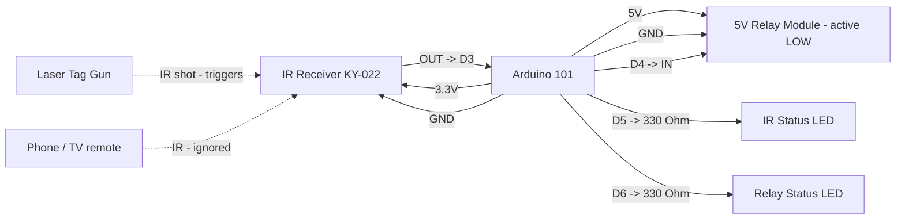

# Arduino 101 Laser Tag IR Negative Trigger Pinout

**Created:** 2026-10-20
**Last Updated:** 2026-10-20

Target sketch:

- `components/arduino101/Arduino101_LaserTagIRNegativeTrigger/Arduino101_LaserTagIRNegativeTrigger.ino`

Any shot from the Sharper Image laser tag gun at the IR receiver pulls the negative trigger output (relay) LOW for 500 ms.
Other IR sources, such as iPhone Face ID/proximity IR, TV remotes, and sunlight, are ignored. The simple IR sketches can't
make that distinction, because they trigger on any IR activity.

## Board Setup

- Board: Arduino/Genuino 101 (`Intel:arc32:arduino_101`); Arduino IDE 1.8.19 or arduino-cli
- Port: confirm with `.\tools\arduino\arduino.ps1 ports` (the bench units enumerate as COM6 and COM7; other units differ)
- Serial Monitor: `115200` baud
- No external libraries. IRremote does not support the Arduino 101, so the sketch decodes the receiver timing itself.
- Windows 11: if uploads hang at `Waiting for device...`, install the WinUSB DFU driver with Zadig (see `SETUP_GUIDE.md` Step 4).
- Close the Serial Monitor before uploading. If the upload stalls waiting for the device, press MASTER RESET as soon as the upload starts.
- Arduino 101 I/O runs at 3.3 V (inputs are 5 V tolerant).

## Function Map

| Function                | Arduino 101 pin | Signal / behavior                                         |
| ----------------------- | --------------- | --------------------------------------------------------- |
| IR receiver signal      | D3              | Idles HIGH; LOW while IR is received                      |
| Negative trigger output | D4              | Idle open (high-Z); LOW for 500 ms after a laser tag shot |
| IR status LED           | D5              | On for 100 ms after any IR activity (including ignored IR) |
| Relay status LED        | D6              | On while the relay is switched on                         |
| IR receiver power       | 3.3V            | Power the receiver from 3.3 V                             |
| Common ground           | GND             | Shared by board, receiver, relay, and LEDs                |

The wiring is identical to the simple IR negative trigger sketches, so you can swap sketches without rewiring.

## Serial Output Path

- All messages print on **USB Serial** (`Serial`) through the USB connector; no GPIO pin carries serial text.
- Open the Serial Monitor on the board's COM port at `115200` baud.
- Expected messages:
  - At startup: `Arduino 101 laser tag IR negative trigger ready`
  - `Trigger: any laser tag shot (9-bit frame) -> negative trigger LOW for 500 ms`
  - Every 5 seconds: `Heartbeat: IR input D3, negative trigger output D4, trigger: any laser tag shot, shots 0, other codes 0`
  - Each gun shot: `Laser tag shot: code 0x147 (9 bits 101000111, 5 frames) -> TRIGGER: negative trigger LOW for 500 ms`
  - Phone or other unknown IR: `IR ignored: unrecognized signal, 11 marks/spaces, first mark 9795 us, first space 6478 us`
  - NEC TV-style remote: `IR NEC address 0x00, command 0x45, raw 0xBA45FF00 -> ignored (not a laser tag shot)`

## Laser Tag Signal Format

Measured from the bench gun on 2026-10-20:

| Part    | Timing / content                                                                                   |
| ------- | -------------------------------------------------------------------------------------------------- |
| Leader  | ~6.0 ms mark + ~0.5 ms space                                                                       |
| Bits    | 9 bits, first bit = most significant. **1** = ~1.5 ms mark + ~0.5 ms space; **0** = ~0.5 ms mark + ~1.5 ms space |
| Repeats | Each shot sends the frame 5 times, ~4.5 ms apart                                                   |

Codes seen so far: `0x14F` (`101001111`), `0x143`, `0x14B`, `0x145`, `0x147`. The leading `10100` stayed the same in every
shot. The remaining bits change with the gun's team/mode settings.

### Trigger rule and tuning

- **Default:** any 9-bit laser tag frame received at least twice in one shot triggers, whatever the team/mode setting.
- `GUN_FRAME_BITS` (default `9`): required frame length. `0` accepts any length from 6 to 16 bits.
- `GUN_CODE_MASK` / `GUN_CODE_VALUE` (default `0` = any code): restrict which shots trigger. For example, mask `0x1F0`
  with value `0x140` requires the `10100` header, or mask `0x1FF` with value `0x147` accepts only one team/mode.
- `PW_CONFIRM_FRAMES` (default `2`): identical frames needed per shot. The gun sends 5, so this rejects partial or garbled hits.
- `TRIGGER_PULSE_MS` (default `500`): relay on-time per shot. Continuous fire keeps the relay on.
- `PRINT_UNKNOWN_TIMINGS` (default `false`): set to `true` to dump the full mark/space timings of unrecognized IR, for example to add another gun.

## Power and Ground

| Device                  | Arduino 101 connection                     |
| ----------------------- | ------------------------------------------ |
| IR receiver VCC         | 3.3V                                       |
| IR receiver GND         | GND                                        |
| Relay module VCC        | 5V pin (one module) or external 5 V supply |
| Relay module GND        | Common GND with Arduino 101                |
| External 5 V supply GND | Common GND with Arduino 101                |

**Relay power:** The board's 5V pin can power one small relay module. For several relays, use a separate regulated 5 V supply and connect its ground to the Arduino 101 GND.

## Board Power Input (Onboard Connector)

| Input Path        | Connector Available | Minimum Input            | Maximum Input             | Notes                                                                        |
| ----------------- | ------------------- | ------------------------ | ------------------------- | ---------------------------------------------------------------------------- |
| USB power         | Yes (USB)           | 4.75V                    | 5.25V                     | Preferred for bench setup and programming.                                   |
| Barrel jack / VIN | Yes                 | 7V (recommended minimum) | 12V (recommended maximum) | Board family limit is wider, but 7V to 12V is the practical operating range. |

## Wiring

| Arduino 101 pin | Connect to                     | Notes                              |
| --------------- | ------------------------------ | ---------------------------------- |
| D3              | IR receiver OUT/S              | IR signal input                    |
| 3.3V            | IR receiver VCC                | Do not power the receiver from 5 V |
| D4              | Relay module IN                | Active LOW; released when idle     |
| 5V              | Relay module VCC               | 5 V relay coil supply              |
| D5              | 330 Ohm -> IR status LED anode | LED cathode to GND                 |
| D6              | 330 Ohm -> relay LED anode     | LED cathode to GND                 |
| GND             | Receiver, relay, and LED GND   | Grounds must be common             |

```text
Arduino 101                               IR receiver (KY-022 / VS1838B / TL1838)
3.3V -----------------------------------> VCC
D3 <------------------------------------- OUT / S
GND ------------------------------------> GND

Arduino 101                               5 V relay module (active LOW)
D4 -------------------------------------> IN
5V -------------------------------------> VCC
GND ------------------------------------> GND

Arduino 101                               Status LEDs
D5 -------------------------------------> 330 Ohm -> IR LED (+) ; LED (-) -> GND
D6 -------------------------------------> 330 Ohm -> relay LED (+) ; LED (-) -> GND
```

## Example Layout Wiring Diagram



### Signal Summary

- D3: IR receiver input, polled continuously. D3 has no both-edge interrupt on the Arduino 101, so the sketch times edges in `loop()`.
- D4: negative trigger output. Released (high-impedance) when idle; LOW for 500 ms after each laser tag shot.
- D5: IR status LED. On for 100 ms after any IR activity, including signals that are then ignored.
- D6: relay status LED. On whenever D4 is switching the relay on.

## Relay Logic

- The sketch is configured for an **active LOW** 5 V relay module.
- `LOW` on D4 energizes the relay. When idle, D4 is released instead of driven HIGH, because a 3.3 V HIGH may not fully switch off a 5 V active-LOW module. The module holds IN at 5 V, so the relay stays off, including during reset and boot. This is safe because the Arduino 101 pins are 5 V tolerant.
- **Do not add a pull-down on D4;** it would switch the relay on. If your module's IN pin floats when disconnected, add a 10 kOhm pull-up from IN to 5V instead.
- Each shot starts or restarts the 500 ms pulse.

## Required Components and Resistor Guidance

- 1x Arduino/Genuino 101
- 1x KY-022 (TL1838/VS1838B) 38 kHz IR receiver module
- 1x Sharper Image laser tag gun (or another gun with the same signal format)
- 1x 5 V active-LOW relay module (one channel)
- 2x LEDs and 2x 330 Ohm resistors for the status LEDs (about 4 mA each at 3.3 V)
- 1x regulated 5 V supply if you power more than one relay module
- Optional 1x 10 kOhm pull-up from relay IN to 5V, only if the module's IN pin floats
- Jumper wires and a common ground

### Wiring notes for safe signal conditioning

1. Connect D4 directly to the relay module's IN pin, with no pull-down on D4.
2. Use a relay module with its own transistor driver and flyback diode. Never wire a bare relay coil to a GPIO.
3. Keep the IR receiver, relay module, and any external 5 V supply on a common ground.
4. Shade the receiver from direct sunlight and strong lamps. Strong ambient IR can swamp it and garble shots.

## Status LED Troubleshooting

| IR LED    | Relay LED   | Relay  | Likely cause / what to check                                                          |
| --------- | ----------- | ------ | ------------------------------------------------------------------------------------- |
| Off       | Off         | Off    | No IR at receiver: check 3.3V, GND, OUT -> D3, gun batteries, aim                     |
| Flashes   | Off         | Off    | IR seen but not a valid shot: read the serial line (phone/remote = expected)          |
| Flashes   | Off         | Off    | Gun shot shows `IR ignored`: set `PRINT_UNKNOWN_TIMINGS = true` and check the timings |
| Flashes   | On ~0.5 s   | Off    | Sketch triggered: check D4 -> IN, relay 5V/GND, active LOW module                     |
| Off       | Off         | On     | IN held LOW: remove any pull-down on D4; confirm active LOW module                    |
| Flashes   | On ~0.5 s   | Clicks | Working normally                                                                      |

## Validation

1. Upload: `.\tools\arduino\arduino.ps1 upload Arduino101_LaserTagIRNegativeTrigger -Port COMx` (close the Serial Monitor first).
2. Open the Serial Monitor at `115200` and press RESET. Confirm the startup banner and a heartbeat every 5 seconds.
3. Fire the gun at the receiver. Confirm `Laser tag shot: ... -> TRIGGER` and that the relay turns on for about 0.5 seconds.
4. Change the gun's team/mode and fire again. Confirm it still triggers. The code value may change.
5. Hold a phone near the receiver and unlock it with Face ID. Confirm `IR ignored: unrecognized signal` (or nothing) and that the relay stays off.
6. Press buttons on a TV remote. Confirm `-> ignored` and that the relay stays off.
7. Power-cycle the board. Confirm the relay does not click on during boot.

Bench result (2026-10-20, COM7 unit): 10 of 10 gun shots triggered (code `0x147`), and an iPhone IR burst was ignored.
