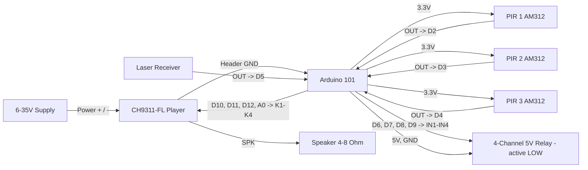

# Arduino 101 PIR / Laser CH9311 Sound Trigger Pinout

**Created:** 2026-10-23
**Last Updated:** 2026-10-23

Target sketch:

- `components/arduino101/Arduino101_PIRLaserCH9311Trigger/Arduino101_PIRLaserCH9311Trigger.ino`

Up to three PIR motion sensors and one laser beam-break sensor each play their own sound on a CH9311-FL voice playback module and pull their own negative trigger output LOW while that sound plays. This is the CH9311 version of `Arduino101_PIRLaserSoundTrigger` (DFPlayer Mini); the trigger logic is identical.

## How the Arduino Controls the CH9311

The CH9311 has **no serial (RX/TX) control**. It is a "low level control" module: its header has ten key inputs, **K1-K10**, and holding a key at GND plays that key's sound (one-to-one). The CH9312 is the "high level" version, triggered by VIN instead; this sketch is for the CH9311 only.

The Arduino 101 "presses" K1-K4 by pulling them to GND for 200 ms. Each sensor has its own key:

| Sensor | CH9311 key | Sound   | SENSOR_SOUND_MS   |
| ------ | ---------- | ------- | ----------------- |
| PIR 1  | K1         | Sound 1 | Length of sound 1 |
| PIR 2  | K2         | Sound 2 | Length of sound 2 |
| PIR 3  | K3         | Sound 3 | Length of sound 3 |
| Laser  | K4         | Sound 4 | Length of sound 4 |

The module's **Busy** marking is an indicator LED next to the USB-C port, not a header pin. So by default the sketch can't tell when a sound ends; instead it holds each sensor's output LOW for that sensor's `SENSOR_SOUND_MS`. **Set each value to the length of its sound** (default 10 s). If you tap a wire from the Busy LED, the sketch can follow the real sound length instead; see [Optional Busy Tap](#optional-busy-tap).

## Before Wiring: Measure the K Pins

The manual doesn't say what voltage the K pins rest at. On a board that runs from up to 35 V, they could be pulled up above 5 V, which would damage the Arduino 101.

1. Power the CH9311 from its supply, with nothing connected to the header.
2. Measure from **K1** to the header **GND** with a multimeter.
3. Choose the wiring:
   - **5 V or less:** wire directly (below), and leave `KEY_DRIVE_VIA_TRANSISTOR = false`. The Arduino 101 pins are 5 V tolerant.
   - **More than 5 V:** use one NPN transistor per key (below), and set `KEY_DRIVE_VIA_TRANSISTOR = true`.

## Board Setup

- Board: Arduino/Genuino 101 (`Intel:arc32:arduino_101`); Arduino IDE 1.8.19 preferred
- Port: confirm in **Tools → Port** (Arduino 101 boards on the bench enumerate on different COM ports)
- Serial Monitor: `115200` baud
- No external libraries
- CLI build: `tools/arduino/arduino.ps1 compile Arduino101_PIRLaserCH9311Trigger`
- If Windows shows the board as a generic USB Serial Device, reinstall the Intel Curie board package drivers.
- If the upload stalls waiting for the device, press MASTER RESET as soon as the upload starts.
- Arduino 101 I/O runs at 3.3 V (inputs are 5 V tolerant).

## CH9311 Module Setup

1. **Load the sounds:** connect the module's USB-C port to a computer and copy the sound files to it. Copy them one at a time in order (sound 1 first), because K1-K10 usually follow the order the files were copied. Use the CH9311-**FL** (8 MB onboard memory); the **-TF** version reads a TF card instead.
2. **Set the playback mode:** the 3-position DIP switch selects one of 8 playback modes. Choose the one-to-one mode in which a short press of a key plays that key's sound once. The switch positions are printed on the board: a switch to the right is `0`, to the left is `1`.
3. **Test before connecting the Arduino:** with the module powered, briefly touch a jumper from **K1** to header **GND**. Sound 1 should play once. Repeat for K2-K4. If this doesn't work, fix the DIP switch mode or the files first.
4. **Set the volume** with the blue VOL trimmer.

| CH9311 connection | Where on the board                      | Use in this project                   |
| ----------------- | --------------------------------------- | ------------------------------------- |
| Power + / Power - | Screw terminal next to the SPK terminal | 6-35 V DC supply (12 V typical)       |
| SPK               | Screw terminal                          | 4-8 Ohm speaker, up to 20 W           |
| GND               | Header, next to K1                      | Common ground with the Arduino 101    |
| K1-K4             | Header pins 1-4                         | Driven by D10, D11, D12, A0           |
| K5-K10            | Header pins 5-10                        | Unused; leave unconnected             |
| VOL               | Blue trimmer pot                        | Sets the volume                       |
| DIP switch 1-3    | Red 3-position switch                   | Selects the playback mode             |
| Busy              | LED next to USB-C                       | Lights while playing (indicator only) |
| USB-C             | Next to the Busy LED                    | Copies sound files from a computer    |
| 12V OUTPUT        | Two-pin pad                             | Not used                              |
| DAC / GND         | Two-pin pad                             | Line-level audio out; not used        |

## Function Map

| Function               | Arduino 101 pin   | Signal / behavior                           |
| ---------------------- | ----------------- | ------------------------------------------- |
| PIR 1 input            | D2                | HIGH on motion; plays sound 1               |
| PIR 2 input            | D3                | HIGH on motion; plays sound 2               |
| PIR 3 input            | D4                | HIGH on motion; plays sound 3               |
| Laser sensor input     | D5                | HIGH when beam is broken; plays sound 4     |
| PIR 1 trigger output   | D6                | Idle open (high-Z); LOW while sound 1 plays |
| PIR 2 trigger output   | D7                | Idle open (high-Z); LOW while sound 2 plays |
| PIR 3 trigger output   | D8                | Idle open (high-Z); LOW while sound 3 plays |
| Laser trigger output   | D9                | Idle open (high-Z); LOW while sound 4 plays |
| CH9311 K1 press        | D10               | Pulls K1 to GND for 200 ms                  |
| CH9311 K2 press        | D11               | Pulls K2 to GND for 200 ms                  |
| CH9311 K3 press        | D12               | Pulls K3 to GND for 200 ms                  |
| CH9311 K4 press        | A0                | Pulls K4 to GND for 200 ms                  |
| CH9311 Busy (optional) | A1                | Only if tapped from the Busy LED            |
| Playing status LED     | D13 (onboard LED) | On while any sound is playing               |

## Serial Output Path

- All messages print on **USB Serial** (`Serial`) through the USB connector.
- Open the Serial Monitor on the board's COM port at `115200` baud.
- Expected messages:
  - At startup: `Arduino 101 PIR/laser CH9311 sound trigger ready`, one line per sensor (input, output, CH9311 key, sound time), then the key drive mode and end-of-sound mode
  - Every 5 seconds: `Heartbeat: CH9311 idle` (or `playing <sensor>`)
  - On a trigger: `PIR 1 triggered: output D6 LOW, pressing CH9311 K1`
  - When the sound time ends: `PIR 1 released: sound time elapsed` (or `sound finished` with the Busy tap)
  - While another sound plays: `PIR 2 ignored: PIR 1 sound still playing`
  - During cooldown: `PIR 1 ignored: cooldown, 9 s left`

The CH9311 sends nothing back, so the sketch can't confirm that a sound actually played. The Busy LED on the module, and your ears, are the check.

## Power and Ground

| Device              | Connection                                           |
| ------------------- | ---------------------------------------------------- |
| CH9311 Power +      | External 6-35 V supply (+); never the Arduino 5V pin |
| CH9311 Power -      | External supply (-)                                  |
| CH9311 GND (header) | Arduino 101 GND                                      |
| AM312 PIR VCC (x3)  | Arduino 101 3.3V                                     |
| Laser receiver VCC  | Arduino 101 3.3V or 5V (match module spec)           |
| Relay module VCC    | Arduino 101 5V (one module) or external 5 V supply   |
| All grounds         | Common GND with Arduino 101                          |

The CH9311 draws up to 1 A while playing; size its supply for that. The header GND **must** connect to the Arduino 101 GND, or the key presses have no shared reference.

## Board Power Input (Onboard Connector)

| Input Path        | Connector Available | Minimum Input            | Maximum Input             | Notes                                                                        |
| ----------------- | ------------------- | ------------------------ | ------------------------- | ---------------------------------------------------------------------------- |
| USB power         | Yes (USB)           | 4.75V                    | 5.25V                     | Preferred for bench setup and programming.                                   |
| Barrel jack / VIN | Yes                 | 7V (recommended minimum) | 12V (recommended maximum) | Board family limit is wider, but 7V to 12V is the practical operating range. |

The Arduino 101 can share a 12 V CH9311 supply through its barrel jack. Do not use a supply above 12 V for the Arduino.

## Wiring

Direct wiring, for K pins that measured **5 V or less**:

| Arduino 101 pin | Connect to            | Notes                             |
| --------------- | --------------------- | --------------------------------- |
| D10             | CH9311 K1             | LOW = press; high-Z = released    |
| D11             | CH9311 K2             | LOW = press; high-Z = released    |
| D12             | CH9311 K3             | LOW = press; high-Z = released    |
| A0              | CH9311 K4             | LOW = press; high-Z = released    |
| GND             | CH9311 GND (header)   | Must share ground with the module |
| D2              | PIR 1 OUT             | AM312: HIGH on motion             |
| D3              | PIR 2 OUT             | AM312: HIGH on motion             |
| D4              | PIR 3 OUT             | AM312: HIGH on motion             |
| D5              | Laser receiver OUT    | HIGH when beam is broken          |
| 3.3V            | AM312 VCC (all three) | AM312 is a 3.3 V sensor           |
| D6              | Relay 1 IN            | Active LOW; released when idle    |
| D7              | Relay 2 IN            | Active LOW; released when idle    |
| D8              | Relay 3 IN            | Active LOW; released when idle    |
| D9              | Relay 4 IN            | Active LOW; released when idle    |
| 5V              | Relay module VCC      | 5 V relay coil supply             |
| GND             | Sensor and relay GND  | Grounds must be common            |

```text
External 6-35 V supply                    CH9311-FL
+ (12 V typical) -----------------------> Power +
- --------------------------------------> Power -

Arduino 101                               CH9311-FL header
GND ------------------------------------> GND
D10 ------------------------------------> K1
D11 ------------------------------------> K2
D12 ------------------------------------> K3
A0 -------------------------------------> K4
                                          SPK terminal -> 4-8 Ohm speaker
```

Transistor wiring, for K pins that measured **more than 5 V** (set `KEY_DRIVE_VIA_TRANSISTOR = true`):

```text
Arduino 101                               One NPN per key (2N3904 / 2N2222)
D10 ------------------------------------> 1 kOhm -> base
                                          collector -> CH9311 K1
                                          emitter   -> GND (common)
(repeat for D11 -> K2, D12 -> K3, A0 -> K4)
```

In transistor mode the pin goes HIGH to press, which turns the transistor on and pulls the key to GND. The transistor keeps the module's voltage off the Arduino pin.

Sensors and relays:

```text
Arduino 101                               Sensors
3.3V -----------------------------------> VCC of PIR 1, 2, 3
D2 <------------------------------------- PIR 1 OUT
D3 <------------------------------------- PIR 2 OUT
D4 <------------------------------------- PIR 3 OUT
D5 <------------------------------------- Laser receiver OUT
GND ------------------------------------> GND of all sensors

Arduino 101                               5 V relay modules (active LOW)
D6 -------------------------------------> Relay 1 IN (PIR 1)
D7 -------------------------------------> Relay 2 IN (PIR 2)
D8 -------------------------------------> Relay 3 IN (PIR 3)
D9 -------------------------------------> Relay 4 IN (laser)
5V -------------------------------------> VCC
GND ------------------------------------> GND
```

## Example Layout Wiring Diagram



### Signal Summary

- D2-D4: PIR inputs. Each fires when its output rises HIGH (motion starts).
- D5: laser input. Fires when its output rises HIGH (beam broken).
- D6-D9: negative trigger outputs, one per sensor. Released (high-impedance) when idle; LOW while that sensor's sound plays.
- D10, D11, D12, A0: CH9311 K1-K4. Each is pulled to GND for 200 ms to start its sound.
- A1: optional Busy tap (unused by default).
- D13: onboard LED, on while any sound is playing.

## Trigger Logic

- **Edge triggered:** a sensor fires once when it *becomes* active. A sensor that stays active (a PIR still seeing motion, or a beam that stays blocked) does not re-fire until it goes inactive and trips again.
- **One sound at a time:** when a sensor fires, its output goes LOW and its K pin is pressed. Until that sound's time ends, every other trigger is **ignored, not queued**.
- **Output follows the sound:** the sensor's output stays LOW for its `SENSOR_SOUND_MS` (or until the Busy tap shows the sound has finished).
- **15-second cooldown per sensor:** a sensor can't fire again until 15 seconds after it last fired. Each sensor has its own cooldown; one sensor's cooldown never blocks another sensor. A trigger that is ignored because another sound is playing does not start a cooldown.
- **Startup warm-up:** triggers are ignored for the first 10 seconds while the sensors settle.

## Relay Logic

- The sketch is configured for **active LOW** 5 V relay modules.
- `LOW` on D6-D9 energizes the matching relay. When idle, each output is released instead of driven HIGH, because a 3.3 V HIGH may not fully switch off a 5 V active-LOW module. The module holds IN at 5 V, so the relays stay off, including during reset and boot. This is safe because the Arduino 101 pins are 5 V tolerant.
- **Do not add pull-downs on D6-D9;** they would switch the relays on. If a module's IN pin floats when disconnected, add a 10 kOhm pull-up from IN to 5V instead.

## Optional Busy Tap

The Busy LED lights while a sound plays. To let the sketch follow the real sound length instead of `SENSOR_SOUND_MS`:

1. With the module playing a sound, measure the voltage on each side of the Busy LED (to header GND) and find the side that changes between playing and idle.
2. Only use it if that side stays between 0 and 5 V. Solder a thin wire from it to **A1**.
3. Set `USE_BUSY_PIN = true`, and set `BUSY_ACTIVE_LEVEL` to `LOW` or `HIGH` to match the level while playing.

With the Busy tap enabled, the sketch also releases an output and prints `no playback detected` if no sound starts within 1.5 seconds of a key press. As a safety limit, an output is released after 3 minutes even if Busy still shows playing.

## Sketch Settings

| Setting                  | Default    | Meaning                                                       |
| ------------------------ | ---------- | ------------------------------------------------------------- |
| KEY_DRIVE_VIA_TRANSISTOR | false      | true if K pins idle above 5 V and you use NPN transistors     |
| SENSOR_SOUND_MS          | 10000 each | How long each sensor's output stays LOW (set to sound length) |
| USE_BUSY_PIN             | false      | true only if you tapped the Busy LED to A1                    |
| BUSY_ACTIVE_LEVEL        | LOW        | Level on A1 while playing (only with USE_BUSY_PIN)            |
| KEY_PRESS_MS             | 200        | How long each K pin is held at GND                            |
| SENSOR_ENABLED           | all true   | Set unused sensors to false so a floating input can't trigger |
| SENSOR_ACTIVE_LEVEL      | all HIGH   | Set a sensor to LOW if its module pulls LOW when active       |
| COOLDOWN_MS              | 15000      | Per-sensor cooldown between triggers                          |
| SENSOR_WARMUP_MS         | 10000      | Triggers ignored after power-up                               |

## Required Components and Resistor Guidance

- 1x Arduino/Genuino 101
- 1x CH9311-FL voice playback module, with sounds loaded
- 1x 6-35 V DC supply for the CH9311, rated at least 1 A (12 V typical)
- 1x speaker, 4 Ω or 8 Ω, rated for your volume (up to 20 W)
- Up to 3x AM312 mini PIR motion sensors
- 1x laser emitter + laser receiver module (output HIGH when the beam is broken)
- 1x 4-channel 5 V active-LOW relay module (or individual modules)
- Only if the K pins measure above 5 V: 4x NPN transistors (2N3904 or 2N2222) and 4x 1 kOhm base resistors
- Optional 10 kOhm pull-ups from relay IN to 5V, only if a module's IN pin floats
- Jumper wires and a common ground

### Wiring notes for safe signal conditioning

1. Measure the K pins before connecting them to the Arduino (see [Before Wiring](#before-wiring-measure-the-k-pins)).
2. Leave K5-K10 unconnected.
3. Run the speaker wires directly from the CH9311 SPK terminal; never through the Arduino.
4. Connect D6-D9 directly to the relay modules' IN pins, with no pull-downs.
5. Use relay modules with their own transistor drivers and flyback diodes. Never wire a bare relay coil to a GPIO.
6. If a sensor isn't connected, set it to `false` in `SENSOR_ENABLED` or tie its input pin to GND.
7. Keep the CH9311, sensors, relay modules, and any external supply on a common ground with the Arduino 101.

## Operation

- No blocking delays or sleep calls are used; all timing uses `millis()`.
- A serial heartbeat every 5 seconds reports whether a sound is playing.

## Troubleshooting

| Symptom                                  | Likely cause / what to check                                           |
| ---------------------------------------- | ---------------------------------------------------------------------- |
| Trigger prints, but no sound             | No module power, K wire wrong, no common GND, or wrong DIP mode        |
| Jumper K1 to GND plays nothing           | DIP switch mode or sound files: fix the module before the Arduino      |
| Plays the wrong sound                    | File order on the module differs from K1-K4                            |
| Sound cut off or next sound starts early | SENSOR_SOUND_MS shorter than the sound                                 |
| Long gap before next trigger works       | SENSOR_SOUND_MS longer than the sound                                  |
| Sensor fires but nothing happens         | Another sound is playing, or that sensor is still in its 15 s cooldown |
| Random triggers with nothing in front    | Unused sensor input left floating: disable it in SENSOR_ENABLED        |
| Laser fires constantly                   | Beam misaligned, or module is LOW-on-break: flip SENSOR_ACTIVE_LEVEL   |
| Relay stays on after the sound           | Pull-down on the output pin, or module is not active LOW               |

## Validation

1. Load the sounds, set the DIP switch, and confirm each of K1-K4 plays the right sound with a jumper to GND (see [CH9311 Module Setup](#ch9311-module-setup)).
2. Measure K1 to GND and choose direct or transistor wiring.
3. Set `SENSOR_SOUND_MS` to the length of each sound, and `KEY_DRIVE_VIA_TRANSISTOR` to match your wiring.
4. Select **Arduino/Genuino 101** and the board's port, then upload. If the upload stalls, press MASTER RESET as soon as the upload starts.
5. Open the Serial Monitor at `115200` and press RESET. Confirm the startup banner and the key drive mode line.
6. Wait 10 seconds for the warm-up, then trip PIR 1. Confirm sound 1 plays, relay 1 turns on, and `PIR 1 released: sound time elapsed` prints as the sound ends.
7. While sound 1 is playing, trip PIR 2. Confirm `PIR 2 ignored: PIR 1 sound still playing` and that sound 1 keeps playing.
8. After sound 1 ends, trip PIR 1 again within 15 seconds of its first trigger. Confirm `PIR 1 ignored: cooldown`.
9. Break the laser beam. Confirm sound 4 plays and relay 4 turns on.
10. Power-cycle the board. Confirm no relay clicks on and no sound plays during boot.
