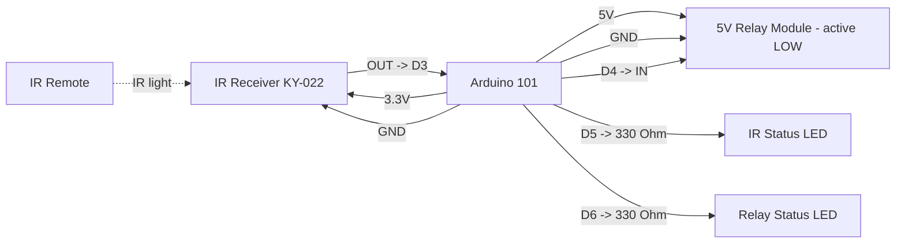

# Arduino 101 Simple IR Negative Trigger Pinout

**Created:** 2026-10-19
**Last Updated:** 2026-10-19

Target sketch:

- `components/arduino101/Arduino101_SimpleIRNegativeTrigger/Arduino101_SimpleIRNegativeTrigger.ino`

## Board Setup

- Board: Arduino/Genuino 101 (`Intel:arc32:arduino_101`); Arduino IDE 1.8.19 preferred
- Port: COM5 on the main bench setup. Confirm in **Tools → Port**, because other units can enumerate differently (one tested unit used COM11).
- Serial Monitor: `115200` baud
- No external libraries. IRremote does not support the Arduino 101, so the sketch reads the IR receiver pin directly.
- If Windows shows the board as a generic USB Serial Device, reinstall the Intel Curie board package drivers.
- If the upload stalls waiting for the device, press MASTER RESET as soon as the upload starts.
- Arduino 101 I/O runs at 3.3 V (inputs are 5 V tolerant).

## Function Map

| Function                | Arduino 101 pin | Signal / behavior                           |
| ----------------------- | --------------- | ------------------------------------------- |
| IR receiver signal      | D3              | Idles HIGH; LOW while IR is received        |
| Negative trigger output | D4              | Idle open (high-Z); LOW for 500 ms after IR |
| IR status LED           | D5              | On for 100 ms after any IR activity         |
| Relay status LED        | D6              | On while the relay is switched on           |
| IR receiver power       | 3.3V            | Power the receiver from 3.3 V               |
| Common ground           | GND             | Shared by board, receiver, relay, and LEDs  |

## Serial Output Path

- All messages print on **USB Serial** (`Serial`) through the USB connector; no GPIO pin carries serial text.
- Open the Serial Monitor on the board's COM port at `115200` baud.
- Expected messages:
  - At startup: `Arduino 101 simple IR negative trigger ready`
  - After the banner: `Status LEDs: IR D5, relay D6`
  - Every 5 seconds: `Heartbeat: IR input D3, negative trigger output D4`
  - When IR starts a trigger: `IR signal received; negative trigger LOW for 500 ms`

## Power and Ground

| Device                  | Arduino 101 connection                     |
| ----------------------- | ------------------------------------------ |
| IR receiver VCC         | 3.3V                                       |
| IR receiver GND         | GND                                        |
| Relay module VCC        | 5V pin (one module) or external 5 V supply |
| Relay module GND        | Common GND with Arduino 101                |
| External 5 V supply GND | Common GND with Arduino 101                |

**Relay power:** The board's 5V pin can power one small relay module. For several relays, use a separate regulated 5 V supply and connect its ground to the Arduino 101 GND.

## Board Power Input (Onboard Connector)

| Input Path        | Connector Available | Minimum Input            | Maximum Input             | Notes                                                                                 |
| ----------------- | ------------------- | ------------------------ | ------------------------- | ------------------------------------------------------------------------------------- |
| USB power         | Yes (USB)           | 4.75V                    | 5.25V                     | Preferred for bench setup and programming.                                            |
| Barrel jack / VIN | Yes                 | 7V (recommended minimum) | 12V (recommended maximum) | Board family limit is wider, but 7V to 12V is the practical operating range.          |

## Wiring

| Arduino 101 pin | Connect to                     | Notes                              |
| --------------- | ------------------------------ | ---------------------------------- |
| D3              | IR receiver OUT/S              | IR signal input                    |
| 3.3V            | IR receiver VCC                | Do not power the receiver from 5 V |
| D4              | Relay module IN                | Active LOW; released when idle     |
| 5V              | Relay module VCC               | 5 V relay coil supply              |
| D5              | 330 Ohm -> IR status LED anode | LED cathode to GND                 |
| D6              | 330 Ohm -> relay LED anode     | LED cathode to GND                 |
| GND             | Receiver, relay, and LED GND   | Grounds must be common             |

```text
Arduino 101                               IR receiver
3.3V -----------------------------------> VCC
D3 <------------------------------------- OUT / S
GND ------------------------------------> GND

Arduino 101                               5 V relay module (active LOW)
D4 -------------------------------------> IN
5V -------------------------------------> VCC
GND ------------------------------------> GND

Arduino 101                               Status LEDs
D5 -------------------------------------> 330 Ohm -> IR LED (+) ; LED (-) -> GND
D6 -------------------------------------> 330 Ohm -> relay LED (+) ; LED (-) -> GND
```

## Example Layout Wiring Diagram



### Signal Summary

- D3: IR receiver input. Idles HIGH and goes LOW during IR bursts.
- D4: negative trigger output. Released (high-impedance) when idle; LOW until 500 ms after the last IR activity.
- D5: IR status LED. On for 100 ms after any LOW on D3, including noise too short to trigger the relay.
- D6: relay status LED. On whenever D4 is switching the relay on.

## Relay Logic

- The sketch is configured for an **active LOW** 5 V relay module.
- `LOW` on D4 energizes the relay. When idle, D4 is released instead of driven HIGH, because a 3.3 V HIGH may not fully switch off a 5 V active-LOW module. The module holds IN at 5 V, so the relay stays off, including during reset and boot. This is safe because the Arduino 101 pins are 5 V tolerant.
- **Do not add a pull-down on D4;** it would switch the relay on. If your module's IN pin floats when disconnected, add a 10 kOhm pull-up from IN to 5V instead.
- The polarity is fixed in the sketch; there is no `RELAY_ACTIVE_LOW` setting. For a 3.3 V positive-trigger relay, use the positive-trigger pattern from the ESP-12F simple sketch.
- The output is pulse-based: each IR burst restarts the 500 ms timer.

## Required Components and Resistor Guidance

- 1x Arduino/Genuino 101
- 1x KY-022 (TL1838/VS1838B) IR receiver module
- 1x IR remote transmitter (any common remote works)
- 1x 5 V active-LOW relay module (one channel)
- 1x regulated 5 V supply if you power more than one relay module
- Optional 1x 10 kOhm pull-up from relay IN to 5V, only if the module's IN pin floats
- 2x LEDs and 2x 330 Ohm resistors for the status LEDs (about 4 mA each at 3.3 V)
- Jumper wires and a common ground

### Wiring notes for safe signal conditioning

1. Connect D4 directly to the relay module's IN pin, with no pull-down on D4.
2. Use a relay module with its own transistor driver and flyback diode. Never wire a bare relay coil to a GPIO.
3. Keep the IR receiver, relay module, and any external 5 V supply on a common ground.

## Operation

- Any IR burst that holds the receiver output LOW for at least 200 µs drives D4 LOW.
- D4 is released 500 ms after the last IR activity, so holding a remote button keeps the relay on.
- Any IR source triggers the relay; the sketch does not decode or filter remote buttons.
- The IR status LED lights for 100 ms after any receiver activity. The relay status LED follows the relay output.
- No blocking delays or sleep calls are used.
- A serial heartbeat prints the IR input and output pin numbers every 5 seconds.

## Status LED Troubleshooting

When the relay doesn't trigger, the two status LEDs show where the chain breaks: IR receiver, sketch, or relay. The IR LED shows raw receiver activity, so it can flash even when the sketch ignores the signal.

| IR LED    | Relay LED  | Relay  | Likely cause / what to check                                        |
| --------- | ---------- | ------ | ------------------------------------------------------------------- |
| Off       | Off        | Off    | No IR at receiver: check 3.3V, GND, OUT -> D3, remote battery       |
| Flashes   | Off        | Off    | Only noise blips under 200 us: move remote closer, shade receiver   |
| Flashes   | On ~500 ms | Off    | Sketch triggered: check D4 -> IN, relay 5V/GND, active LOW module   |
| On steady | On steady  | On     | Receiver output stuck LOW: check receiver power, sunlight, IR lamps |
| Off       | Off        | On     | IN held LOW: remove any pull-down on D4; confirm active LOW module  |
| Flashes   | On ~500 ms | Clicks | Working normally                                                    |

## Validation

1. Select **Arduino/Genuino 101** and the board's port, then upload. If the upload stalls, press MASTER RESET as soon as the upload starts.
2. Open the Serial Monitor at `115200` and press RESET. Confirm the startup banner and a heartbeat every 5 seconds.
3. With no IR present, confirm the relay and both status LEDs are off.
4. Press any remote button at the receiver. Confirm `IR signal received; negative trigger LOW for 500 ms`, that the IR LED flashes, and that the relay LED and relay turn on for about 500 ms. If not, use the status LED table above.
5. Hold a button. Confirm the relay stays on and releases about 500 ms after you let go.
6. Power-cycle the board. Confirm the relay does not click on during boot.
