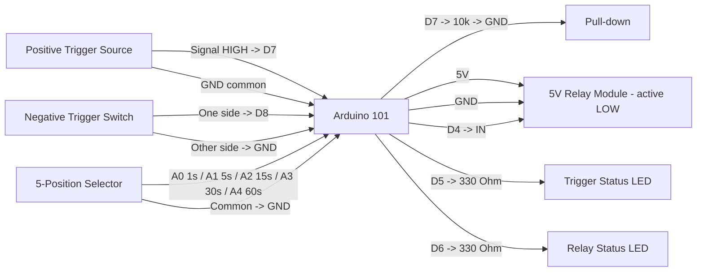

# Arduino 101 Timed Trigger Relay Pinout

**Created:** 2026-10-20
**Last Updated:** 2026-10-26

> **Archived 2026-10-26 (never deployed).** Use `components/arduino101/Arduino101_LaserTagIRTrigger` with its D2 wired
> input (`wired_input` setting) instead. Issues: floating positive input on D7, pins that conflict with the unified
> layout, and retired 30/60 s options. See the header of `Arduino101_TimedTriggerRelay.ino`.

Target sketch:

- `archive/arduino101/Arduino101_TimedTriggerRelay/Arduino101_TimedTriggerRelay.ino`

A positive (active HIGH) or negative (active LOW) trigger input switches a relay on for a selectable 1, 5, 15, 30, or 60 seconds.

## Board Setup

- Board: Arduino/Genuino 101 (`Intel:arc32:arduino_101`); Arduino IDE 1.8.19 or arduino-cli
- Port: confirm with `.\tools\arduino\arduino.ps1 ports` (the bench unit enumerates as COM6; other units differ)
- Serial Monitor: `115200` baud
- No external libraries.
- Windows 11: if uploads hang at `Waiting for device...`, install the WinUSB DFU driver with Zadig (see `SETUP_GUIDE.md` Step 4).
- If the upload stalls waiting for the device, press MASTER RESET as soon as the upload starts.
- Arduino 101 I/O runs at 3.3 V (inputs are 5 V tolerant).

## Function Map

| Function                 | Arduino 101 pin | Signal / behavior                                                    |
| ------------------------ | --------------- | -------------------------------------------------------------------- |
| Positive trigger input   | D7              | Active HIGH. Needs an external 10 kOhm pull-down to GND              |
| Negative trigger input   | D8              | Active LOW. Internal pull-up; switch or open-collector output to GND |
| Relay output             | D4              | Idle open (high-Z); LOW for the selected duration                    |
| Trigger status LED       | D5              | On while either enabled trigger input is active                      |
| Relay status LED         | D6              | On while the relay is switched on                                    |
| Duration select 1 s      | A0              | Ground to select. Internal pull-up                                   |
| Duration select 5 s      | A1              | Ground to select. Internal pull-up                                   |
| Duration select 15 s     | A2              | Ground to select. Internal pull-up                                   |
| Duration select 30 s     | A3              | Ground to select. Internal pull-up                                   |
| Duration select 60 s     | A4              | Ground to select. Internal pull-up                                   |
| Common ground            | GND             | Shared by board, trigger sources, selector, relay, and LEDs          |

## Duration Selector

Ground exactly one of A0-A4 to choose the relay on-time. Use a 1-pole 5-position rotary switch (common to GND), a 5-position DIP switch (all common sides to GND), or a jumper wire.

| Grounded pin  | Relay on-time |
| ------------- | ------------- |
| A0            | 1 s           |
| A1            | 5 s           |
| A2            | 15 s          |
| A3            | 30 s          |
| A4            | 60 s          |
| None          | 1 s (default) |
| More than one | Shortest of the grounded options, with a serial warning |

- The selector is read continuously. A change applies to the **next** trigger. A pulse already running keeps the duration it started with.
- Each selector change prints `Duration selector: ...` on the serial port.
- To change the no-selection default, edit `DEFAULT_DURATION_MS` in the sketch.

## Serial Output Path

- All messages print on **USB Serial** (`Serial`) through the USB connector; no GPIO pin carries serial text.
- Open the Serial Monitor on the board's COM port at `115200` baud.
- Expected messages:
  - At startup: `Arduino 101 timed trigger relay ready`, followed by the input, relay, LED, and selector pin map
  - Selector state: `Duration selector: 15 s (A2)`
  - Every 5 seconds: `Heartbeat: duration 15 s | Positive D7 idle | Negative D8 idle | relay off`
  - On a trigger: `Negative trigger on D8 -> relay ON for 15 s`
  - Trigger during a pulse: `Positive trigger ignored: relay pulse already running`
  - Pulse end: `Relay pulse complete -> relay OFF`
  - Input held active at boot: `Negative input is active at boot; release it to arm`

## Power and Ground

| Device                         | Arduino 101 connection                     |
| ------------------------------ | ------------------------------------------ |
| Positive trigger source GND    | Common GND with Arduino 101                |
| Negative trigger switch/sensor | Between D8 and GND                         |
| Duration selector common       | GND                                        |
| Relay module VCC               | 5V pin (one module) or external 5 V supply |
| Relay module GND               | Common GND with Arduino 101                |
| External 5 V supply GND        | Common GND with Arduino 101                |

**Relay power:** The board's 5V pin can power one small relay module. For several relays, use a separate regulated 5 V supply and connect its ground to the Arduino 101 GND.

## Board Power Input (Onboard Connector)

| Input Path        | Connector Available | Minimum Input            | Maximum Input             | Notes                                                                        |
| ----------------- | ------------------- | ------------------------ | ------------------------- | ---------------------------------------------------------------------------- |
| USB power         | Yes (USB)           | 4.75V                    | 5.25V                     | Preferred for bench setup and programming.                                   |
| Barrel jack / VIN | Yes                 | 7V (recommended minimum) | 12V (recommended maximum) | Board family limit is wider, but 7V to 12V is the practical operating range. |

## Wiring

| Arduino 101 pin | Connect to                                 | Notes                                        |
| --------------- | ------------------------------------------ | -------------------------------------------- |
| D7              | Positive trigger signal                    | 10 kOhm from D7 to GND; signal at most 5 V   |
| D8              | Negative trigger switch / sensor output    | Other side of switch to GND                  |
| A0-A4           | Selector positions 1 / 5 / 15 / 30 / 60 s  | Selector common to GND                       |
| D4              | Relay module IN                            | Active LOW; released when idle               |
| 5V              | Relay module VCC                           | 5 V relay coil supply                        |
| D5              | 330 Ohm -> trigger LED anode               | LED cathode to GND                           |
| D6              | 330 Ohm -> relay LED anode                 | LED cathode to GND                           |
| GND             | Triggers, selector, relay, and LED grounds | Grounds must be common                       |

```text
Arduino 101                               Positive trigger source (active HIGH)
D7 <------------------------------------- Signal (3.3 V or 5 V when active)
D7 ---- 10 kOhm ----> GND                 (pull-down keeps D7 LOW when idle)
GND ------------------------------------> Source GND

Arduino 101                               Negative trigger (active LOW)
D8 <------------------------------------- Switch / sensor output
GND ------------------------------------> Switch other side / sensor GND

Arduino 101                               Duration selector (rotary or DIP)
A0 -------------------------------------> 1 s position
A1 -------------------------------------> 5 s position
A2 -------------------------------------> 15 s position
A3 -------------------------------------> 30 s position
A4 -------------------------------------> 60 s position
GND ------------------------------------> Common / wiper

Arduino 101                               5 V relay module (active LOW)
D4 -------------------------------------> IN
5V -------------------------------------> VCC
GND ------------------------------------> GND

Arduino 101                               Status LEDs
D5 -------------------------------------> 330 Ohm -> trigger LED (+) ; LED (-) -> GND
D6 -------------------------------------> 330 Ohm -> relay LED (+) ; LED (-) -> GND
```

## Example Layout Wiring Diagram



### Signal Summary

- D7: positive trigger input, active HIGH. Requires an external pull-down, because the Arduino 101 has no internal pull-down.
- D8: negative trigger input, active LOW. Uses the internal pull-up.
- A0-A4: duration selector inputs with internal pull-ups. Grounded = selected.
- D4: relay output. Released (high-impedance) when idle; LOW for the selected duration.
- D5: trigger status LED. Follows the debounced state of the enabled trigger inputs.
- D6: relay status LED. On whenever D4 is switching the relay on.

## Relay Logic

- The sketch is configured for an **active LOW** 5 V relay module.
- `LOW` on D4 energizes the relay. When idle, D4 is released instead of driven HIGH, because a 3.3 V HIGH may not fully switch off a 5 V active-LOW module. The module holds IN at 5 V, so the relay stays off, including during reset and boot. This is safe because the Arduino 101 pins are 5 V tolerant.
- **Do not add a pull-down on D4;** it would switch the relay on. If your module's IN pin floats when disconnected, add a 10 kOhm pull-up from IN to 5V instead.
- The polarity is fixed in the sketch; there is no `RELAY_ACTIVE_LOW` setting.

## Trigger Logic

- **Edge-triggered:** a pulse starts when an input changes from idle to active (debounced for 30 ms). Holding an input active does not retrigger. It must return to idle before it can start another pulse.
- **Lockout while on:** triggers that arrive while a pulse is running are ignored and logged. When the pulse ends, an input that is still held active does not fire again until it is released.
- **Either input:** D7 and D8 are independent. Whichever goes active first starts the pulse.
- **Boot safety:** an input that is already active at power-up does not fire. It must be released first.
- **Unused input:** set `POSITIVE_TRIGGER_ENABLED` or `NEGATIVE_TRIGGER_ENABLED` to `false` for an input that is not wired. An unwired D7 without its pull-down floats and can cause false triggers.
- No blocking delays are used in `loop()`.

## Required Components and Resistor Guidance

- 1x Arduino/Genuino 101
- 1x 5 V active-LOW relay module (one channel)
- 1x 10 kOhm resistor: pull-down from D7 to GND (required if the positive input is enabled)
- 1x 1-pole 5-position rotary switch, 5-position DIP switch, or jumper wire for the duration selector
- Positive trigger source (3.3 V or 5 V logic output) and/or negative trigger switch or open-collector sensor
- 2x LEDs and 2x 330 Ohm resistors for the status LEDs (about 4 mA each at 3.3 V)
- 1x regulated 5 V supply if you power more than one relay module
- Optional 1x 10 kOhm pull-up from relay IN to 5V, only if the module's IN pin floats
- Jumper wires and a common ground

### Wiring notes for safe signal conditioning

1. Keep the positive trigger signal at 5 V or less. For 12 V or 24 V sources, use an optocoupler or a voltage divider.
2. Always fit the 10 kOhm pull-down on D7, so the input stays LOW when the source is disconnected or off.
3. Wire the negative trigger as a dry contact or open-collector/open-drain output to GND. Do not drive D8 above 5 V.
4. For long trigger wires, use twisted pair with ground, and consider a 100 nF capacitor from the input to GND for noise.
5. Connect D4 directly to the relay module IN with no pull-down. Use a relay module with its own transistor driver and flyback diode.

## Status LED Troubleshooting

| Trigger LED | Relay LED            | Relay   | Likely cause / what to check                                                     |
| ----------- | -------------------- | ------- | -------------------------------------------------------------------------------- |
| Off         | Off                  | Off     | Trigger not reaching the pin: check D7 signal and pull-down, or D8 switch to GND |
| On steady   | Off                  | Off     | Input was active at boot or stuck: release the input, check wiring              |
| Flickers    | On randomly          | Clicks  | D7 floating: fit 10 kOhm pull-down, or disable the unused input                  |
| On briefly  | On for wrong time    | Clicks  | Check selector wiring and the `Duration selector:` serial message               |
| On briefly  | On for selected time | Off     | Sketch working: check D4 -> IN, relay 5V/GND, active LOW module                 |
| Off         | Off                  | On      | IN held LOW: remove any pull-down on D4; confirm active LOW module              |
| On briefly  | On for selected time | Clicks  | Working normally                                                                 |

## Validation

1. Upload: `.\tools\arduino\arduino.ps1 upload Arduino101_TimedTriggerRelay -Port COMx`. If the upload stalls, press MASTER RESET as soon as the upload starts.
2. Open the Serial Monitor at `115200` and press RESET. Confirm the startup banner, the selector line, and a heartbeat every 5 seconds.
3. With no selector pin grounded, confirm `Duration selector: no pin grounded, using default 1 s`.
4. Ground A0, then A1, A2, A3, and A4 in turn. Confirm each `Duration selector:` message shows 1, 5, 15, 30, and 60 s.
5. With A1 (5 s) selected, briefly connect D8 to GND. Confirm `Negative trigger on D8 -> relay ON for 5 s`, then `Relay pulse complete -> relay OFF` about 5 seconds later.
6. Briefly drive D7 HIGH (for example, from 3.3V through a jumper). Confirm `Positive trigger on D7 -> relay ON for 5 s`.
7. During a pulse, trigger the other input. Confirm `trigger ignored: relay pulse already running` and that the pulse still ends on time.
8. Hold D8 LOW past the end of a pulse. Confirm it does not retrigger until you release it and pull it LOW again.
9. Hold D8 LOW and press RESET. Confirm `Negative input is active at boot; release it to arm` and that the relay does not turn on.
10. Power-cycle the board. Confirm the relay does not click on during boot.
