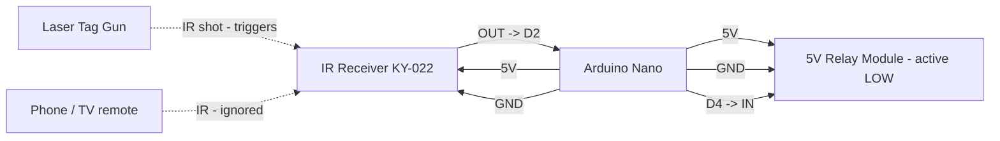

# Arduino Nano Laser Tag IR Negative Trigger (5 s) Pinout

**Created:** 2026-10-23
**Last Updated:** 2026-10-23

Target sketch:

- `components/nano/Nano_LaserTagIRNegativeTrigger5s/Nano_LaserTagIRNegativeTrigger5s.ino`

Any shot from the Sharper Image laser tag gun at the IR receiver pulls the negative trigger output (relay) LOW for 5 seconds.
Other IR sources, such as iPhone Face ID/proximity IR, TV remotes, and sunlight, are ignored.

This is the 5-second variant of `components/nano/Nano_LaserTagIRNegativeTrigger` (identical except `TRIGGER_PULSE_MS = 5000`).
That sketch is the Arduino Nano port of `components/uno/UNO_LaserTagIRNegativeTrigger` (same decoder as the Arduino 101 laser tag
sketches). The pins follow `Nano_Node`: IR on D2, relay on D4 (`Nano_Node` Relay 1).

## Board Setup

- Arduino board target: `Arduino Nano`, Processor **ATmega328P** (`arduino:avr:nano:cpu=atmega328`, new bootloader); Arduino IDE 2.x or arduino-cli
- Old-bootloader Nanos: if an upload fails with `not in sync`, pass `-Fqbn arduino:avr:nano:cpu=atmega328old`. The bench Nano
  (CH340, COM15) turned out to have the **new** bootloader even though the old one was expected, so check each board.
- If an upload hangs instead of failing, or later uploads report the port busy or `Access denied`, a stuck `avrdude` is holding the
  port. Unplug and replug the Nano to release it.
- Port: confirm with `.\tools\arduino\arduino.ps1 ports`. CH340-based clones show as "USB-SERIAL CH340" and are not auto-identified, so always pass `-Port`.
- Serial Monitor: `115200` baud
- No external libraries. IRremote has no decoder for this gun's format, so the sketch times the receiver output itself.
- Nano I/O runs at 5 V.
- Close the Serial Monitor before uploading.

## Function Map

| Function                | Nano pin       | Signal / behavior                                     |
| ----------------------- | -------------- | ----------------------------------------------------- |
| IR receiver signal      | D2             | Idles HIGH; LOW while IR is received                  |
| Negative trigger output | D4             | Idle 5 V HIGH; LOW for 5 seconds after a laser tag shot  |
| Relay status LED        | D13 (onboard)  | Onboard "L" LED; on while the relay is switched on     |
| Not used                | D5, D6         | Left as inputs (`Nano_Node` Relay 2/3 pins)           |
| IR receiver power       | 5V             | KY-022 runs from 5 V on the Nano                      |
| Common ground           | GND            | Shared by board, receiver, and relay                  |

**Nano_Node compatibility:** if the Nano is wired for `Nano_Node` with a 3-channel relay board on D4/D5/D6, only the D4 relay
is used. D5 and D6 stay as inputs; an active-LOW relay module's own pull-ups hold those channels off.

## Serial Output Path

- All messages print on **USB Serial** (`Serial`) through the USB connector; no GPIO pin carries serial text.
- Open the Serial Monitor on the board's COM port at `115200` baud.
- Expected messages:
  - At startup: `Arduino Nano laser tag IR negative trigger (5 s) ready`
  - `Trigger: any laser tag shot (9-bit frame) -> negative trigger LOW for 5000 ms`
  - `Relay status LED: onboard D13`
  - Every 5 seconds: `Heartbeat: IR input D2, negative trigger output D4, trigger: any laser tag shot, shots 0, other codes 0`
  - Each gun shot: `Laser tag shot: code 0x147 (9 bits 101000111, 5 frames) -> TRIGGER: negative trigger LOW for 5000 ms`
  - Phone or other unknown IR: `IR ignored: unrecognized signal, 11 marks/spaces, first mark 9795 us, first space 6478 us`
  - NEC TV-style remote: `IR NEC address 0x00, command 0x45, raw 0xBA45FF00 -> ignored (not a laser tag shot)`

## Laser Tag Signal Format

Measured from the bench gun on 2026-10-20:

| Part    | Timing / content                                                                                   |
| ------- | -------------------------------------------------------------------------------------------------- |
| Leader  | ~6.0 ms mark + ~0.5 ms space                                                                       |
| Bits    | 9 bits, first bit = most significant. **1** = ~1.5 ms mark + ~0.5 ms space; **0** = ~0.5 ms mark + ~1.5 ms space |
| Repeats | Each shot sends the frame 5 times, ~4.5 ms apart                                                   |

Codes seen so far: `0x14F` (`101001111`), `0x143`, `0x14B`, `0x145`, `0x147`. The leading `10100` stayed the same in every
shot. The remaining bits change with the gun's team/mode settings.

### Trigger rule and tuning

- **Default:** any 9-bit laser tag frame received at least twice in one shot triggers, whatever the team/mode setting.
- `GUN_FRAME_BITS` (default `9`): required frame length. `0` accepts any length from 6 to 16 bits.
- `GUN_CODE_MASK` / `GUN_CODE_VALUE` (default `0` = any code): restrict which shots trigger. For example, mask `0x1F0`
  with value `0x140` requires the `10100` header, or mask `0x1FF` with value `0x147` accepts only one team/mode.
- `PW_CONFIRM_FRAMES` (default `2`): identical frames needed per shot. The gun sends 5, so this rejects partial or garbled hits.
- `TRIGGER_PULSE_MS` (default `5000`): relay on-time per shot. Continuous fire keeps the relay on.
- `PRINT_UNKNOWN_TIMINGS` (default `false`): set to `true` to dump the full mark/space timings of unrecognized IR.

## Power and Ground

| Device                  | Nano connection                            |
| ----------------------- | ------------------------------------------ |
| IR receiver VCC         | 5V                                         |
| IR receiver GND         | GND                                        |
| Relay module VCC        | 5V pin (one module) or external 5 V supply |
| Relay module GND        | Common GND with Nano                       |
| External 5 V supply GND | Common GND with Nano                       |

**Relay power:** The Nano's 5V pin can power one small relay module. For several relays, use a separate regulated 5 V supply and connect its ground to the Nano GND.

## Board Power Input (Onboard Connector)

| Input Path                    | Connector Available                        | Minimum Input            | Maximum Input             | Notes                                                                                |
| ----------------------------- | ------------------------------------------ | ------------------------ | ------------------------- | ------------------------------------------------------------------------------------ |
| USB power                     | Yes, USB on the Nano board                 | 4.75V                    | 5.25V                     | Preferred for bench setup and programming.                                           |
| Barrel jack on breakout board | Yes, via the external power breakout board | 7V (recommended minimum) | 12V (recommended maximum) | Use this when powering the Nano from a wall adapter; the board regulates it to 5V.  |

## Wiring

| Nano pin | Connect to                   | Notes                                        |
| -------- | ---------------------------- | -------------------------------------------- |
| D2       | IR receiver OUT/S            | IR signal input                              |
| 5V       | IR receiver VCC              | KY-022 runs from 5 V on the Nano             |
| D4       | Relay module IN              | Active LOW; idle 5 V HIGH                    |
| 5V       | Relay module VCC             | 5 V relay coil supply                        |
| GND      | Receiver and relay GND       | Grounds must be common                       |

```text
Arduino Nano                              IR receiver (KY-022 / VS1838B / TL1838)
5V -------------------------------------> VCC
D2 <------------------------------------- OUT / S
GND ------------------------------------> GND

Arduino Nano                              5 V relay module (active LOW)
D4 -------------------------------------> IN (IN1 on a multi-channel Nano_Node relay board)
5V -------------------------------------> VCC
GND ------------------------------------> GND

Onboard "L" LED (D13) = relay status, no wiring
```

## Example Layout Wiring Diagram



### Signal Summary

- D2: IR receiver input, polled continuously in `loop()` (same decoder as the Arduino 101 and UNO sketches).
- D4: negative trigger output. Idle 5 V HIGH; LOW for 5 seconds after each laser tag shot.
- D13: onboard LED, on whenever D4 is switching the relay on.

## Relay Logic

- The sketch is configured for an **active LOW** 5 V relay module.
- `LOW` on D4 energizes the relay; `HIGH` (5 V) holds it off. The Nano is a 5 V board, so D4 is driven HIGH directly.
- At power-up, D4 is set HIGH before it becomes an output, so the relay does not click on during boot. During reset and in the bootloader, D4 is an input and the relay module's own pull-up holds it off.
- If your relay board is active HIGH, swap `LOW`/`HIGH` in `setTrigger()` and in the `digitalWrite(NEGATIVE_TRIGGER_PIN, HIGH)` line in `setup()`.
- Each shot starts or restarts the 5-second pulse.

## Required Components and Resistor Guidance

- 1x Arduino Nano (ATmega328P)
- 1x KY-022 (TL1838/VS1838B) 38 kHz IR receiver module
- 1x Sharper Image laser tag gun (or another gun with the same signal format)
- 1x 5 V active-LOW relay module (one channel, or channel 1 of a `Nano_Node` relay board)
- 1x regulated 5 V supply if you power more than one relay module
- Jumper wires and a common ground

### Wiring notes for safe signal conditioning

1. Use a relay module with its own transistor driver and flyback diode. Never wire a bare relay coil to a GPIO.
2. Keep the IR receiver, relay module, and any external 5 V supply on a common ground.
3. Shade the receiver from direct sunlight and strong lamps. Strong ambient IR can swamp it and garble shots.

## Troubleshooting

| Onboard LED | Relay  | Serial message                   | Likely cause / what to check                                                  |
| ----------- | ------ | -------------------------------- | ----------------------------------------------------------------------------- |
| Off         | Off    | Nothing on a shot                | No IR at receiver: check 5V, GND, OUT -> D2, gun batteries, aim               |
| Off         | Off    | `IR ignored` on a gun shot       | Set `PRINT_UNKNOWN_TIMINGS = true` and check the timings                       |
| Off         | Off    | `IR ignored` / NEC on phone/remote | Expected: only the gun triggers                                             |
| On ~5 s     | Off    | `Laser tag shot ... TRIGGER`     | Sketch triggered: check D4 -> IN, relay 5V/GND, active LOW module             |
| Off         | On     | -                                | Relay inverted: confirm the module is active LOW                              |
| On ~5 s     | Clicks | `Laser tag shot ... TRIGGER`     | Working normally                                                              |

## Validation

1. Upload: `.\tools\arduino\arduino.ps1 upload Nano_LaserTagIRNegativeTrigger5s -Port COMx` (close the Serial Monitor first).
2. Open the Serial Monitor at `115200`. Confirm the startup banner and a heartbeat every 5 seconds.
3. Fire the gun at the receiver. Confirm `Laser tag shot: ... -> TRIGGER`, that the onboard LED lights, and that the relay turns on for about 5 seconds.
4. Change the gun's team/mode and fire again. Confirm it still triggers. The code value may change.
5. Hold a phone near the receiver and unlock it with Face ID. Confirm `IR ignored: unrecognized signal` (or nothing) and that the relay stays off.
6. Power-cycle the board. Confirm the relay does not click on during boot.

The decoder was bench-verified on the Arduino 101 version (10 of 10 shots triggered, iPhone IR ignored). This 5 s Nano sketch
was uploaded to COM15 (CH340 clone, new bootloader) on 2026-10-23, and its banner (`LOW for 5000 ms`) and heartbeat were confirmed.
