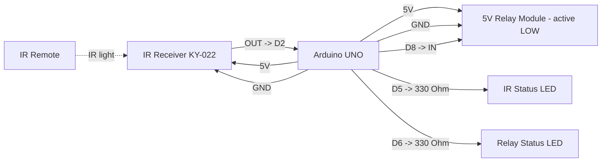

# Arduino UNO Simple IR Negative Trigger Pinout

**Created:** 2026-10-19
**Last Updated:** 2026-10-19

Target sketch:

- `components/uno/UNO_SimpleIRNegativeTrigger/UNO_SimpleIRNegativeTrigger.ino`

## Board Setup

- Arduino board target: `Arduino Uno` (`arduino:avr:uno`)
- Port: COM7 on the bench setup. Confirm in **Tools → Port**.
- Serial Monitor: `115200` baud
- Required library: IRremote by Arduino-IRremote
- UNO I/O runs at 5 V.
- If an upload fails with `not in sync: resp=0x00`, the board's bootloader is not responding. Close any Serial Monitor, try another cable and USB port, and press RESET just as the upload starts. If it still fails, re-burn the bootloader with an ISP programmer.

## Function Map

| Function                | UNO pin | Signal / behavior                           |
| ----------------------- | ------- | ------------------------------------------- |
| IR receiver signal      | D2      | Receives decoded IR signals                 |
| Negative trigger output | D8      | Idle 5 V HIGH; LOW for 500 ms per IR signal |
| IR status LED           | D5      | On for 100 ms after any IR activity         |
| Relay status LED        | D6      | On while the relay is switched on           |
| IR receiver power       | 5V      | Power the receiver from 5 V                 |
| Common ground           | GND     | Shared by board, receiver, relay, and LEDs  |

## Serial Output Path

- All messages print on **USB Serial** (`Serial`) through the USB connector; no GPIO pin carries serial text.
- Open the Serial Monitor on the board's COM port at `115200` baud.
- Expected messages:
  - At startup: `Simple IR -> negative trigger node ready`, followed by `IR receiver pin: D2`, `Negative trigger output pin: D8`, and `Status LEDs: IR D5, relay D6`
  - Every 5 seconds: `Heartbeat: IR input D2, output D8`
  - On each decoded IR signal: `IR signal received on D2 -> negative trigger D8 LOW for 500 ms`

## Power and Ground

| Device                  | UNO connection                             |
| ----------------------- | ------------------------------------------ |
| IR receiver VCC         | 5V                                         |
| IR receiver GND         | GND                                        |
| Relay module VCC        | 5V pin (one module) or external 5 V supply |
| Relay module GND        | Common GND with UNO                        |
| External 5 V supply GND | Common GND with UNO                        |

**Relay power:** The UNO's 5V pin can power one small relay module. For several relays, use a separate regulated 5 V supply and connect its ground to the UNO GND.

## Board Power Input (Onboard Connector)

| Input Path        | Connector Available                | Minimum Input            | Maximum Input             | Notes                                                                        |
| ----------------- | ---------------------------------- | ------------------------ | ------------------------- | ---------------------------------------------------------------------------- |
| USB power         | Yes (USB-B on UNO R3 class boards) | 4.75V                    | 5.25V                     | Preferred for bench setup and programming.                                   |
| Barrel jack / VIN | Yes                                | 7V (recommended minimum) | 12V (recommended maximum) | Board family limit is wider, but 7V to 12V is the practical operating range. |

## Wiring

| UNO pin | Connect to                     | Notes                           |
| ------- | ------------------------------ | ------------------------------- |
| D2      | IR receiver OUT/S              | IR data input                   |
| 5V      | IR receiver VCC                | KY-022 runs from 5 V on the UNO |
| D8      | Relay module IN                | Active LOW; idle 5 V HIGH       |
| 5V      | Relay module VCC               | 5 V relay coil supply           |
| D5      | 330 Ohm -> IR status LED anode | LED cathode to GND              |
| D6      | 330 Ohm -> relay LED anode     | LED cathode to GND              |
| GND     | Receiver, relay, and LED GND   | Grounds must be common          |

```text
Arduino UNO                               IR receiver
5V -------------------------------------> VCC
D2 <------------------------------------- OUT / S
GND ------------------------------------> GND

Arduino UNO                               5 V relay module (active LOW)
D8 -------------------------------------> IN
5V -------------------------------------> VCC
GND ------------------------------------> GND

Arduino UNO                               Status LEDs
D5 -------------------------------------> 330 Ohm -> IR LED (+) ; LED (-) -> GND
D6 -------------------------------------> 330 Ohm -> relay LED (+) ; LED (-) -> GND
```

## Example Layout Wiring Diagram



### Signal Summary

- D2: IR receiver input, decoded by IRremote.
- D8: negative trigger output. Idle 5 V HIGH; LOW for 500 ms after each decoded IR signal.
- D5: IR status LED. On for 100 ms after any LOW on D2, decoded or not.
- D6: relay status LED. On whenever D8 is switching the relay on.

## Relay Logic

- The sketch is configured for an **active LOW** 5 V relay module.
- `LOW` on D8 energizes the relay. Because the UNO runs at 5 V, its HIGH fully switches the relay off, so D8 is driven HIGH when idle. The Arduino 101 sketch releases its pin instead, because its 3.3 V HIGH may not.
- **Do not add a pull-down on D8;** it would switch the relay on before the sketch starts.
- The polarity is fixed in the sketch; there is no `RELAY_ACTIVE_LOW` setting.
- The output is pulse-based: each decoded IR signal restarts the 500 ms timer.

## Required Components and Resistor Guidance

- 1x Arduino UNO R3 (ATmega328P)
- 1x KY-022 (TL1838/VS1838B) IR receiver module
- 1x IR remote transmitter
- 1x 5 V active-LOW relay module (one channel)
- 1x regulated 5 V supply if you power more than one relay module
- Optional 1x 10 kOhm pull-up from relay IN to 5V, only if the module's IN pin floats
- 2x LEDs and 2x 330 Ohm resistors for the status LEDs (about 9 mA each at 5 V)
- Jumper wires and a common ground

### Wiring notes for safe signal conditioning

1. Connect D8 directly to the relay module's IN pin, with no pull-down on D8.
2. Use a relay module with its own transistor driver and flyback diode. Never wire a bare relay coil to a GPIO.
3. Keep the IR receiver, relay module, and any external 5 V supply on a common ground.

## Operation

- Any IR frame decoded by IRremote drives D8 LOW for 500 ms. A new frame during the pulse restarts the timer.
- D8 returns HIGH after 500 ms. The main loop has no blocking delays or sleep calls; setup waits 100 ms after starting Serial.
- The IR status LED lights for 100 ms after any receiver activity. The relay status LED follows the relay output.
- A serial heartbeat prints the IR input and output pin numbers every 5 seconds.

## Status LED Troubleshooting

When the relay doesn't trigger, the two status LEDs show where the chain breaks: IR receiver, IR decoding, or relay. The IR LED shows raw receiver activity, so it can flash even when IRremote can't decode the signal.

| IR LED    | Relay LED  | Relay  | Likely cause / what to check                                        |
| --------- | ---------- | ------ | ------------------------------------------------------------------- |
| Off       | Off        | Off    | No IR at receiver: check 5V, GND, OUT -> D2, remote battery         |
| Flashes   | Off        | Off    | IR seen but not decoded: try another remote or move closer          |
| Flashes   | On ~500 ms | Off    | Sketch triggered: check D8 -> IN, relay 5V/GND, active LOW module   |
| On steady | Off        | Off    | Receiver output stuck LOW: check receiver power, sunlight, IR lamps |
| Off       | Off        | On     | IN held LOW: remove any pull-down on D8; confirm active LOW module  |
| Flashes   | On ~500 ms | Clicks | Working normally                                                    |

## Validation

1. Select **Arduino Uno** and the board's port, then upload.
2. Open the Serial Monitor at `115200` and press RESET. Confirm the startup banner and a heartbeat every 5 seconds.
3. With no IR present, confirm the relay and both status LEDs are off.
4. Press any remote button at the receiver. Confirm `IR signal received on D2 -> negative trigger D8 LOW for 500 ms`, that the IR LED flashes, and that the relay LED and relay turn on for about 500 ms. If not, use the status LED table above.
5. Power-cycle the board. Confirm the relay does not click on during boot.
