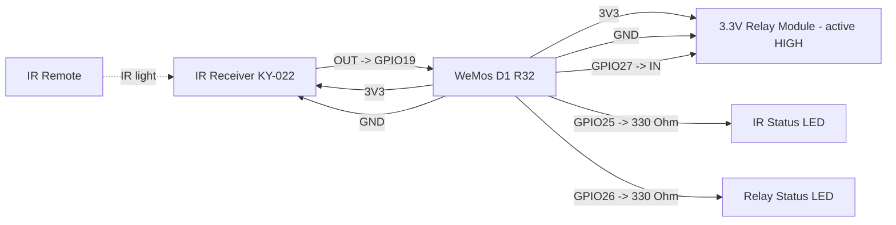

# WeMos D1 R32 Simple IR Positive Trigger Pinout

**Created:** 2026-10-19
**Last Updated:** 2026-10-19

Target sketch:

- `components/wemos_d1_r32/WemosD1R32_SimpleIRPositiveTrigger/WemosD1R32_SimpleIRPositiveTrigger.ino`

## Board Setup

- Arduino board target: `ESP32 Dev Module` (`esp32:esp32:esp32`)
- Port: COM10 on the bench setup (CH340 USB-serial chip). Confirm in **Tools → Port**.
- If Windows shows an unknown device, install the CH340 driver. If uploads fail with `A device attached to the system is not functioning`, the port cannot be opened at all: try another USB port, then an older CH340 driver, then another board.
- Serial Monitor: `115200` baud
- Required library: IRremote by Arduino-IRremote
- ESP32 GPIO is 3.3 V only. Do not connect 5 V signals to GPIO.

## Function Map

| Function                | ESP32 GPIO | Signal / behavior                             |
| ----------------------- | ---------- | --------------------------------------------- |
| IR receiver signal      | GPIO19     | Receives decoded IR signals                   |
| Positive trigger output | GPIO27     | Idle LOW; 3.3 V HIGH for 500 ms per IR signal |
| IR status LED           | GPIO25     | On for 100 ms after any IR activity           |
| Relay status LED        | GPIO26     | On while the relay is switched on             |
| IR receiver power       | 3V3        | Power the receiver from 3.3 V                 |
| Common ground           | GND        | Shared by board, receiver, relay, and LEDs    |

**Wire by GPIO number.** The D1 R32 board's printed D-labels don't match the ESP32 GPIO numbers, and the label tables published for this board disagree. The repo's [D1 R32 pinout](../PINOUT.md) lists GPIO19 as D6 and GPIO27 as D9. Check the GPIO numbers printed on your board, or a pin map for your exact board revision, before wiring.

## Serial Output Path

- All messages print on **USB Serial** (`Serial`) through the USB-serial chip; no GPIO pin carries serial text.
- Open the Serial Monitor on the board's COM port at `115200` baud.
- Expected messages:
  - At startup: `WeMos D1 R32 simple IR positive trigger ready`
  - After the banner: `Status LEDs: IR GPIO25, relay GPIO26`
  - Every 5 seconds: `Heartbeat: IR input GPIO19, positive trigger output GPIO27`
  - On each decoded IR signal: `IR signal received; positive trigger HIGH for 500 ms`

## Power and Ground

| Device           | D1 R32 connection      |
| ---------------- | ---------------------- |
| IR receiver VCC  | 3V3                    |
| IR receiver GND  | GND                    |
| Relay module VCC | 3V3                    |
| Relay module GND | Common GND with D1 R32 |

The relay coil draws its current from the board's 3V3 regulator. One small relay module is normally fine; for more relays, use a separate regulated 3.3 V supply and connect its ground to the D1 R32 GND.

## Board Power Input (Onboard Connector)

| Input Path        | Connector Available  | Minimum Input | Maximum Input | Notes                                                |
| ----------------- | -------------------- | ------------- | ------------- | ---------------------------------------------------- |
| USB power         | Yes (Micro-USB)      | 4.75V         | 5.25V         | Preferred for programming and serial monitoring.     |
| Barrel jack / VIN | Yes (UNO-style jack) | 7V            | 12V           | Regulated on-board. 7-9V recommended to reduce heat. |

## Wiring

| D1 R32 pin | Connect to                     | Notes                              |
| ---------- | ------------------------------ | ---------------------------------- |
| GPIO19     | IR receiver OUT/S              | IR data input                      |
| 3V3        | IR receiver VCC                | Do not power the receiver from 5 V |
| 3V3        | Relay module VCC               | 3.3 V relay coil supply            |
| GPIO27     | Relay module IN                | Active HIGH at 3.3 V; idle LOW     |
| GPIO25     | 330 Ohm -> IR status LED anode | LED cathode to GND                 |
| GPIO26     | 330 Ohm -> relay LED anode     | LED cathode to GND                 |
| GND        | Receiver, relay, and LED GND   | Grounds must be common             |

```text
D1 R32                                    IR receiver
3V3 ------------------------------------> VCC
GPIO19 <--------------------------------- OUT / S
GND ------------------------------------> GND

D1 R32                                    3.3 V relay module (active HIGH)
3V3 ------------------------------------> VCC
GPIO27 ---------------------------------> IN
GND ------------------------------------> GND

D1 R32                                    Status LEDs
GPIO25 ---------------------------------> 330 Ohm -> IR LED (+) ; LED (-) -> GND
GPIO26 ---------------------------------> 330 Ohm -> relay LED (+) ; LED (-) -> GND
```

## Example Layout Wiring Diagram



### Signal Summary

- GPIO19: IR receiver input, decoded by IRremote.
- GPIO27: positive trigger output. Idle LOW; HIGH for 500 ms after each decoded IR signal.
- GPIO25: IR status LED. On for 100 ms after any LOW on GPIO19, decoded or not.
- GPIO26: relay status LED. On whenever GPIO27 is switching the relay on.

## Relay Logic

- The sketch is configured for an **active HIGH** 3.3 V relay module.
- `HIGH` on GPIO27 energizes the relay; GPIO27 is driven LOW when idle.
- The polarity is fixed in the sketch; there is no `RELAY_ACTIVE_LOW` setting. For a 5 V negative-trigger relay, use a 5 V board pattern such as the UNO or Arduino 101 simple sketch.
- GPIO19, GPIO25, GPIO26, and GPIO27 are not boot-strapping pins, so the receiver, relay, and LED wiring do not affect boot. Avoid GPIO0, GPIO2, GPIO12, and GPIO15 for these signals.
- The output is pulse-based: each decoded IR signal restarts the 500 ms timer.

## Required Components and Resistor Guidance

- 1x WeMos D1 R32
- 1x KY-022 (TL1838/VS1838B) IR receiver module
- 1x IR remote transmitter
- 1x 3.3 V active-HIGH relay module (one channel)
- Optional 1x 10 kOhm pull-down from GPIO27 to GND if the relay clicks at power-up
- 2x LEDs and 2x 330 Ohm resistors for the status LEDs (about 4 mA each at 3.3 V)
- Jumper wires and a common ground

### Wiring notes for safe signal conditioning

1. Connect GPIO27 directly to the relay module's IN pin. The module must recognize 3.3 V as HIGH.
2. Use a relay module with its own transistor driver and flyback diode. Never wire a bare relay coil to a GPIO.
3. GPIO27 floats briefly at power-up, before the sketch drives it LOW. If the relay clicks during boot, add the 10 kOhm pull-down.
4. Keep the IR receiver, relay module, and D1 R32 on a common ground.

## Operation

- Any IR frame decoded by IRremote starts or restarts a 500 ms active-HIGH output pulse.
- The output returns LOW after 500 ms without blocking delays or sleep calls.
- The IR status LED lights for 100 ms after any receiver activity. The relay status LED follows the relay output.
- A serial heartbeat prints the IR input and output GPIO numbers every 5 seconds.

## Status LED Troubleshooting

When the relay doesn't trigger, the two status LEDs show where the chain breaks: IR receiver, IR decoding, or relay. The IR LED shows raw receiver activity, so it can flash even when IRremote can't decode the signal.

| IR LED    | Relay LED  | Relay  | Likely cause / what to check                                            |
| --------- | ---------- | ------ | ----------------------------------------------------------------------- |
| Off       | Off        | Off    | No IR at receiver: check 3V3, GND, OUT -> GPIO19, remote battery        |
| Flashes   | Off        | Off    | IR seen but not decoded: try another remote or move closer              |
| Flashes   | On ~500 ms | Off    | Sketch triggered: check GPIO27 -> IN, relay 3V3/GND, active HIGH module |
| On steady | Off        | Off    | Receiver output stuck LOW: check receiver power, sunlight, IR lamps     |
| Off       | Off        | On     | IN held HIGH: remove any pull-up on GPIO27; confirm active HIGH module  |
| Flashes   | On ~500 ms | Clicks | Working normally                                                        |

## Validation

1. Select **ESP32 Dev Module** and the board's port, then upload. If the upload stops at `Connecting...`, hold BOOT until writing starts.
2. Open the Serial Monitor at `115200` and press RESET. Confirm the startup banner and a heartbeat every 5 seconds.
3. With no IR present, confirm the relay and both status LEDs are off.
4. Press any remote button at the receiver. Confirm `IR signal received; positive trigger HIGH for 500 ms`, that the IR LED flashes, and that the relay LED and relay turn on for about 500 ms. If not, use the status LED table above.
5. Power-cycle the board. Confirm the relay does not click on during boot; if it does, add the 10 kOhm pull-down on GPIO27.
