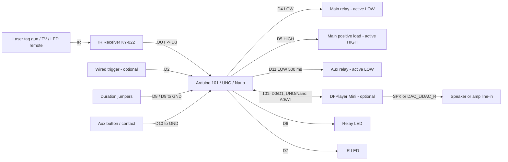

# Laser Tag IR Trigger Pinout (Arduino 101 / UNO / Nano)

**Created:** 2026-10-26
**Last Updated:** 2026-10-26

Target sketches (one shared `.ino`; each folder's `board_config.h` holds its pin map):

- `components/arduino101/Arduino101_LaserTagIRTrigger/Arduino101_LaserTagIRTrigger.ino`
- `components/uno/UNO_LaserTagIRTrigger/UNO_LaserTagIRTrigger.ino`
- `components/nano/Nano_LaserTagIRTrigger/Nano_LaserTagIRTrigger.ino`

WiFi builds of the same sketch (ESP32 / Acebott ESP32-Max, ESP8266, ESP-01) add a settings web page, router or setup-AP
connection, MQTT, and OTA updates: see `components/esp32/ESP32_LaserTagIRTrigger/PINOUT.md`.

**Editing the sketch:** change only this folder's `.ino` (the Arduino 101 copy), then run
`.\tools\arduino\arduino.ps1 sync` to copy it into the UNO, Nano, ESP32, ESP8266, and ESP-01 folders. Pins and
features per board live in each folder's `board_config.h`.

This sketch replaces every earlier laser tag, simple IR, and timed trigger relay sketch (now in `archive/`). It has these triggers:

- **Main (IR):** any valid IR code on D3 (laser tag gun, TV remote, LED-strip remote) pulls **D4 LOW** and drives
  **D5 HIGH** for the duration selected with jumpers on D8/D9 (or the saved setting). Phones and sunlight are ignored.
- **Wired (D2):** optional switch, sensor, or controller input that fires the same main outputs. **Off by default.**
- **Aux:** a HIGH -> LOW edge on **D10** pulls **D11 LOW** for 500 ms (adjustable).
- **Sound (optional):** a DFPlayer Mini, if connected, is detected automatically. IR shots play the files in SD folder
  `01` in order; D2 plays `02/001` and D10 plays `02/002`.
- **Settings** (name, durations, IR types, wired input) are changed over USB with `tools/web-config/index.html` and saved in EEPROM.

## Board Setup

| Board       | Sketch                         | FQBN                             | Logic level |
| ----------- | ------------------------------ | -------------------------------- | ----------- |
| Arduino 101 | `Arduino101_LaserTagIRTrigger` | `Intel:arc32:arduino_101`        | 3.3 V       |
| UNO R3      | `UNO_LaserTagIRTrigger`        | `arduino:avr:uno`                | 5 V         |
| Nano        | `Nano_LaserTagIRTrigger`       | `arduino:avr:nano:cpu=atmega328` | 5 V         |

- Serial Monitor: `115200` baud. No external libraries.
- Close the Serial Monitor before uploading.
- Arduino 101: if the upload stalls, press MASTER RESET as soon as the upload starts. On Windows 11, install the WinUSB
  DFU driver with Zadig (`SETUP_GUIDE.md` Step 4).
- Nano: `not in sync` means the other bootloader; retry with `-Fqbn arduino:avr:nano:cpu=atmega328old`.

## Function Map

| Function                | Pin  | Signal / behavior                                                                  |
| ----------------------- | ---- | ---------------------------------------------------------------------------------- |
| Wired trigger input     | D2   | Fires D4/D5 like an IR code. `wired_input`: 0 off (default), 1 negative, 2 positive |
| IR receiver signal      | D3   | Idles HIGH; LOW while IR is received                                               |
| Main negative trigger   | D4   | **Active LOW** for the selected duration after a valid IR code                     |
| Main positive trigger   | D5   | **Active HIGH** (board logic level) for the same duration; LOW when idle            |
| Relay status LED        | D6   | On while D4/D5 **or** D11 is active                                                |
| IR status LED           | D7   | On for 100 ms after any IR activity, including ignored IR                          |
| Duration select A       | D8   | `INPUT_PULLUP`; jumper to GND = +1                                                 |
| Duration select B       | D9   | `INPUT_PULLUP`; jumper to GND = +2                                                 |
| Aux negative input      | D10  | `INPUT_PULLUP`; fires on HIGH -> LOW (button / dry contact / open-collector to GND) |
| Aux negative output     | D11  | **Active LOW** for 500 ms after an aux input edge                                  |
| DFPlayer TX -> board RX | D0 (101) / A0 (UNO, Nano) | Optional. Arduino 101 uses `Serial1`; UNO/Nano use SoftwareSerial |
| Board TX -> DFPlayer RX | D1 (101) / A1 (UNO, Nano) | Optional. **1 kOhm resistor in series**                  |
| IR receiver power       | 3.3V | Arduino 101: 3.3 V. UNO/Nano: 5 V                                                  |
| Common ground           | GND  | Shared by board, receiver, relays, loads, and LEDs                                 |

**Idle state of the negative outputs (D4, D11):**

- Arduino 101: released (high-Z). A 5 V active-LOW relay module pulls its own IN HIGH; a driven 3.3 V HIGH can leave it
  partly on. **Do not add a pull-down on D4 or D11.**
- UNO/Nano: driven HIGH (5 V).

## Duration Select (D8/D9, read live)

| D8   | D9   | Main pulse (D4/D5)                              |
| ---- | ---- | ----------------------------------------------- |
| open | open | Saved `main_ms` setting (default 0.5 s)         |
| GND  | open | 5 s                                             |
| open | GND  | 10 s                                            |
| GND  | GND  | 15 s                                            |

- **Jumpers win:** any installed jumper overrides the saved `main_ms`. Remove both jumpers to use the saved setting.
- The jumpers are read every 50 ms. A change is logged (`Duration select changed: ...`) and applies to the **next**
  trigger; a pulse already running keeps its length.
- For longer on-times, use a 0.5 s pulse to start a programmable timer relay.
- The aux output (D11) uses the saved `aux_ms` setting (default 500 ms).

## Trigger and Lockout Behavior

- **One event per pulse:** while an output is active, new triggers for that output are ignored (not queued, and the
  timer is **not** restarted). After the pulse ends, the output stays idle for `rearm_ms` (default 250 ms) before it can fire
  again. Edge-triggered props therefore see one clean ON/OFF per pulse, even when several people shoot the target.
- **Main and aux are independent:** an IR code or D2 never fires D11, and D10 never fires D4/D5.

## Wired Trigger Input (D2)

D2 fires the **main** outputs (D4 LOW + D5 HIGH) with the same duration, lockout, and re-arm gap as an IR shot. It is
**off by default**, so a board with nothing on D2 can never fire from it. Set `wired_input` on the config page:

| `wired_input`  | D2 mode        | Fires on    | Wiring                                                                      |
| -------------- | -------------- | ----------- | --------------------------------------------------------------------------- |
| 0 (default)    | Off            | Never       | Leave D2 unconnected                                                        |
| 1 negative     | `INPUT_PULLUP` | HIGH -> LOW | Button, dry contact, relay COM/NO, or open-collector output between D2 and GND |
| 2 positive     | `INPUT`        | LOW -> HIGH | Signal to D2, **plus a 10 kOhm resistor from D2 to GND** (common GND)        |

- 30 ms debounce. Holding D2 active fires once; it must return to idle to re-arm. An input already active at power-up
  (or when the mode is changed) must release first.
- Positive mode needs the pull-down: without it an unwired or disconnected D2 floats and can fire at random.
- Arduino 101 inputs are 5 V tolerant, so a 5 V sensor can drive D2 directly in positive mode.

## MP3 Sound (DFPlayer Mini, optional)

A DFPlayer Mini (or a compatible "Mini MP3" module) adds sound. It is detected automatically about 1.5-7 s after
power-up (`DFPlayer detected` on the serial log). With no module connected, sounds are skipped and everything else
works the same.

| Trigger              | Plays                                                                          |
| -------------------- | ------------------------------------------------------------------------------ |
| IR (main fires)      | Next file in folder `01`: `001`, `002`, `003`, ... then back to `001`          |
| Wired D2 (main fires)| `02/001`                                                                       |
| Aux D10 (D11 fires)  | `02/002`                                                                       |

- A sound plays only when its trigger actually fires. Shots ignored during a pulse do not play or skip a file.
- **Sequence reset:** after `mp3_reset_s` seconds (default 120) with no IR sound, the next shot starts at `01/001`
  again. Set 0 to never reset (the sequence just loops).
- The number of files in folder `01` is read from the card at startup. If that query fails, the sketch finds the end
  when a file is missing and restarts at `001`.
- A new sound interrupts one that is still playing.
- Volume: `mp3_volume` 0-30 (default 25).

### Wiring

| DFPlayer pin   | Arduino 101            | UNO / Nano             | Notes                                              |
| -------------- | ---------------------- | ---------------------- | -------------------------------------------------- |
| VCC            | 5V                     | 5V                     | 3.2-5 V                                            |
| GND            | GND                    | GND                    | Both GND pins on the module are connected together |
| TX             | D0                     | A0                     | Direct                                             |
| RX             | D1 via 1 kOhm          | A1 via 1 kOhm          | The resistor stops buzz/hum and protects the 3.3 V input |
| SPK_1 / SPK_2  | -                      | -                      | Small speaker (up to 3 W, 4-8 Ohm) directly        |
| DAC_R / DAC_L  | -                      | -                      | Line out to an amplifier instead of SPK_1/SPK_2    |
| BUSY           | -                      | -                      | Not used                                           |

```text
Board                                     DFPlayer Mini
5V -------------------------------------> VCC
GND ------------------------------------> GND
D0 (101) / A0 (UNO/Nano) <--------------- TX
D1 (101) / A1 (UNO/Nano) --- 1 kOhm ----> RX
                                          SPK_1 / SPK_2 -> speaker, or DAC_L / DAC_R -> amp line-in
```

Power: the DFPlayer can draw several hundred mA on loud peaks with a speaker on SPK_1/SPK_2. If the board resets or the
sound crackles at high volume, power the DFPlayer from a separate 5 V supply (common GND) or use DAC_L/DAC_R into an amp.

### Line out to an external amplifier (3.5 mm)

Use **DAC_L / DAC_R** for line out. **Do not** wire SPK_1/SPK_2 to a jack or an amp input: they are a bridged amplifier
output with neither side at ground, so connecting one to the amp's ground can distort, hum, or damage the module.

| DFPlayer pin  | 3.5 mm plug     | Cut-cable wire (typical; confirm with a meter) |
| ------------- | --------------- | ---------------------------------------------- |
| DAC_L (pin 5) | Tip (left)      | White or blue                                  |
| DAC_R (pin 4) | Ring (right)    | Red                                            |
| GND (pin 7)   | Sleeve (ground) | Bare or copper shield                          |

```text
          DFPlayer Mini (top view, SD slot at the bottom)
 VCC   1 o            o 16 BUSY
 RX    2 o            o 15 USB-
 TX    3 o            o 14 USB+
 DAC_R 4 o ---------------------> Ring   (R)
 DAC_L 5 o ---------------------> Tip    (L)     3.5 mm jack -> amp LINE IN / AUX
 SPK_1 6 o  (leave empty)
 GND   7 o ---------------------> Sleeve (GND)
 SPK_2 8 o  (leave empty)
```

- Plug into the amp's **LINE IN / AUX**. Not a mic input (distorts) and not the amp's speaker terminals.
- Leave SPK_1/SPK_2 unconnected when using the DAC pins.
- Levels: start with `mp3_volume` about 20 and the amp gain low, then raise the amp. `mp3_volume` also sets the DAC
  level; if the sound distorts, lower `mp3_volume` instead of the amp.
- **Hum/buzz:** usually a ground loop between the board's supply and the amp's. Try another outlet or USB supply for the
  board, or add an inline 3.5 mm ground-loop isolator.
- **Pop at power-up or an amp DC warning:** add a 10 uF capacitor in series on each channel (+ side toward the
  DFPlayer). Most line inputs already block DC, so try without first.
- **Mono amp:** join DAC_L and DAC_R through a 1 kOhm resistor each into the single input. Do not tie them directly.
- **Runs over about 3 m (10 ft):** use shielded audio cable, with the shield on GND at the DFPlayer end only.

### SD card layout

FAT32 micro SD (32 GB or smaller). Folder names are exactly two digits; file names start with three digits.

```text
SD card root
├── 01                      IR shots, played in order
│   ├── 001_scream.mp3
│   ├── 002_laugh.mp3
│   └── 003_growl.mp3        (as many as needed, up to 255)
└── 02
    ├── 001_wired_d2.mp3     D2 wired trigger
    └── 002_aux_d10.mp3      D10 aux trigger
```

- Number the files in folder `01` with no gaps (`001`, `002`, `003`, ...). A gap ends the sequence early.
- Files are found by number, not copy order. On a Mac, delete the hidden `._*` files after copying.

### Notes for the UNO and Nano

The UNO and Nano talk to the DFPlayer with SoftwareSerial on A0/A1. While a reply byte is arriving (about 1 ms per
byte), the board cannot time IR edges. Replies only come right after a command, when a card is inserted or removed,
or when a track ends. In the rare case a track ends during a shot, that one shot may not decode. The Arduino 101 uses
its hardware `Serial1` and is not affected.
- **Aux input:** 30 ms debounce. Holding D10 LOW fires once; it must return HIGH to re-arm. If D10 is already LOW at
  power-up, it must release before it can fire.

## IR Codes Accepted

Any IR frame that decodes cleanly fires the main trigger. Phones (Face ID / camera IR) and sunlight produce irregular
pulses that never form a valid frame.

| Format                       | Typical sources                                         | Serial label        |
| ---------------------------- | ------------------------------------------------------- | ------------------- |
| Pulse width, 6-24 bits       | Laser tag guns (6 ms leader), Sony TVs (2.4 ms leader)  | `laser tag`, `Sony/pulse-width` |
| Pulse distance, 12-64 bits   | NEC (most LED-strip remotes, LG, Vizio, TCL), Samsung, Panasonic, JVC | `NEC`, `Samsung`, `Panasonic`, `pulse-distance` |
| NEC repeat (button held)     | Any NEC remote                                          | Logged, **does not trigger** |

Not decoded: Philips RC5/RC6 (Manchester coding, uncommon in the US). They are logged as `IR ignored: not a valid code`.

**Changes from the archived sketches:** the gun no longer needs exactly 9 bits or 2 matching frames per shot. One
clean frame of 6-24 bits is enough, and a frame can start anywhere in the capture, so clipped shots at range still decode.

## Settings and Configuration Page

Settings are stored in EEPROM and changed over the USB cable, with no reflashing. A new or blank board uses the defaults.

| Setting         | Default | Range       | Effect                                                                    |
| --------------- | ------- | ----------- | ------------------------------------------------------------------------- |
| `name`          | unnamed | 1-16 chars  | Prop name shown in the heartbeat                                          |
| `main_ms`       | 500     | 100-15000   | Main pulse when no duration jumper is installed                           |
| `aux_ms`        | 500     | 100-15000   | D11 pulse                                                                 |
| `rearm_ms`      | 250     | 0-60000     | Idle gap after each pulse; use it as a cooldown (for example 15000 = 15 s) |
| `ir_formats`    | 3       | 1-3         | 1 = laser tag / Sony only, 2 = NEC / Samsung / LED remotes only, 3 = both  |
| `pw_min_frames` | 1       | 1-3         | Matching laser tag frames needed per shot; use 2 if phones or sunlight ever trigger |
| `timings`       | 0       | 0-1         | 1 prints raw mark/space timings for unrecognized IR (to capture a gun that does not fire) |
| `wired_input`   | 0       | 0-2         | D2 wired trigger: 0 off, 1 negative (to GND), 2 positive (needs 10 kOhm pull-down) |
| `mp3_volume`    | 25      | 0-30        | DFPlayer volume                                                           |
| `mp3_reset_s`   | 120     | 0-3600      | Seconds with no IR sound before the folder `01` sequence restarts at `001`; 0 = never |

### Configuration page (recommended)

1. Close the Arduino Serial Monitor and any `arduino.ps1 monitor` session (only one program can use the port).
2. Open `tools/web-config/index.html` in **Chrome** or **Edge** on a computer. Double-clicking the file is fine.
3. Click **Connect**, pick the board's COM port, and wait about 3 s (UNO/Nano reboot when the port opens).
4. Change settings, then click **Apply & Save**. **Apply** alone changes the running board only; it reverts on power-off.
5. Use **Test main** / **Test aux** to fire an output, and watch the serial log on the right.

If the browser blocks the page when it is opened as a file, serve the folder locally and open `http://localhost:8000`:

```powershell
cd C:\GitHub\2026_TiTG_Haunted_Theatre\tools\web-config
python -m http.server 8000
```

### Serial commands (any serial terminal at 115200, newline line endings)

```text
HELP
GET
SET name=Coffin Lid
SET main_ms=2000
SET ir_formats=1
SAVE
DEFAULTS
TEST MAIN
TEST AUX
```

`SET` changes the running board immediately; `SAVE` stores the settings. Every command except `HELP` ends with one
`OK ...`, `ERR ...`, or `CFG end` line. Commands are read between IR frames, so they never disturb decoding.

### Fixed decoder constants (top of the sketch)

| Constant      | Value | Effect                                 |
| ------------- | ----- | -------------------------------------- |
| `PW_MIN_BITS` | `6`   | Shortest pulse-width frame accepted    |
| `PD_MIN_BITS` | `12`  | Shortest pulse-distance frame accepted |

## Wiring

| Pin  | Connect to                                       | Notes                                        |
| ---- | ------------------------------------------------ | -------------------------------------------- |
| D2   | Optional wired trigger source                    | Negative: contact to GND. Positive: signal + 10 kOhm D2-to-GND |
| D3   | IR receiver OUT/S                                | KY-022 / VS1838B / TL1838                    |
| 3.3V | IR receiver VCC (Arduino 101)                    | UNO/Nano: use 5V                             |
| D4   | Active-LOW relay module IN                       | Main negative trigger                        |
| D5   | Active-HIGH relay IN / MOSFET gate / prop input  | Logic signal only; a few mA                  |
| D6   | 330 Ohm -> relay LED anode                       | LED cathode to GND                           |
| D7   | 330 Ohm -> IR LED anode                          | LED cathode to GND                           |
| D8   | Jumper to GND (optional)                         | Duration select A                            |
| D9   | Jumper to GND (optional)                         | Duration select B                            |
| D10  | Button / dry contact / other board's output to GND | Aux negative trigger input                 |
| D11  | Active-LOW relay module IN                       | Aux negative trigger output                  |
| 5V   | Relay module VCC                                 | One small module from the board; two or more need an external 5 V supply |
| GND  | Receiver, relays, loads, LEDs, jumpers, aux source | Grounds must be common                     |

```text
Board                                     Wired trigger (optional, set wired_input)
D2 --[switch / contact]--> GND            wired_input = 1 (negative)
D2 <------------------- sensor OUT        wired_input = 2 (positive)
D2 -- 10 kOhm --> GND                     required for positive mode

Board                                     IR receiver (KY-022 / VS1838B / TL1838)
3.3V (101) or 5V (UNO/Nano) ------------> VCC
D3 <------------------------------------- OUT / S
GND ------------------------------------> GND

Board                                     Main 5 V relay module (active LOW)
D4 -------------------------------------> IN
5V -------------------------------------> VCC
GND ------------------------------------> GND

Board                                     Main positive load (active HIGH)
D5 -------------------------------------> IN / gate / trigger input
GND ------------------------------------> GND
(optional) D5 -- 10 kOhm --> GND          keeps D5 LOW during reset/boot

Board                                     Duration jumpers
D8 --[jumper]--> GND                      +1 (5 s)
D9 --[jumper]--> GND                      +2 (10 s); both = 15 s

Board                                     Aux trigger
D10 --[button / contact]--> GND           aux input
D11 -------------------------------------> aux relay module IN (active LOW)

Board                                     Status LEDs
D6 -------------------------------------> 330 Ohm -> relay LED (+) ; LED (-) -> GND
D7 -------------------------------------> 330 Ohm -> IR LED (+) ; LED (-) -> GND
```



## Rewiring From Archived Sketches

| Archived sketch                                          | Change                                                       |
| -------------------------------------------------------- | ------------------------------------------------------------ |
| `Arduino101_LaserTagIRNegativeTrigger` (500 ms/5 s/10 s/60 s) | Move the IR LED from D5 to D7. Add jumpers for 5 s / 10 s. |
| `Arduino101_LaserTagIRDualTrigger` (500 ms/5 s)          | No rewiring. Add a D8 jumper for 5 s.                        |
| `Arduino101_SimpleIRNegativeTrigger` (all)               | Move the IR LED from D5 to D7.                               |
| `UNO_LaserTagIRNegativeTrigger`, `UNO_SimpleIRNegativeTrigger` | IR D2 -> D3, relay D8 -> D4, IR LED D5 -> D7.          |
| `UNO_LaserTagIRDualTrigger`                              | IR D2 -> D3, negative relay D8 -> D4.                        |
| `Nano_LaserTagIRNegativeTrigger` (500 ms/5 s)            | IR D2 -> D3. Add LEDs on D6/D7 (the onboard D13 LED is no longer used). |

## Electrical Notes

- D5 is a logic output: 3.3 V on the Arduino 101, 5 V on the UNO/Nano. Do not drive a relay coil, motor, or LED strip
  from it directly. On the Arduino 101, check that an active-HIGH relay module switches at 3.3 V.
- Relay power: the board's 5V pin can power one small relay module. With both D4 and D11 relays, use an external
  regulated 5 V supply with its GND tied to the board GND.
- Arduino 101 inputs are 5 V tolerant, so a 5 V source can drive D10 directly (common GND).

## Serial Output

- At startup: `<board> laser tag IR trigger ready (fw 2026-10-26)`, the prop name, and the main/duration/aux/re-arm settings.
- Valid code: `IR laser tag code 0x147 (9 bits, 5 frames) -> TRIGGER: D4 LOW + D5 HIGH for 5000 ms`
- During a pulse: `IR NEC code 0xF708FF00 (32 bits) -> ignored (trigger active)`
- End of pulse: `Main trigger released (D4/D5 idle)`
- Phone / sunlight: `IR ignored: not a valid code (phone, sunlight, or unsupported remote), ...`
- Aux: `Aux D10 LOW -> TRIGGER: D11 LOW for 500 ms`
- Wired D2: `Wired D2 LOW -> TRIGGER: D4 LOW + D5 HIGH for 500 ms`
- DFPlayer: `DFPlayer detected`, `MP3: folder 01 has 3 files`, then `  MP3 play 01/001` under each trigger line
  (or `DFPlayer: none detected (sounds off)` about 7 s after boot)
- Every 5 s: `Heartbeat [Coffin Lid]: main idle, duration 500 ms (no jumper: saved main_ms), aux idle, IR fired 0 ignored 0, aux fired 0 ignored 0`

## Status LED Troubleshooting

| IR LED (D7) | Relay LED (D6) | Likely cause / what to check                                                          |
| ----------- | -------------- | ------------------------------------------------------------------------------------- |
| Off         | Off            | No IR at the receiver: check VCC, GND, OUT -> D3, gun batteries, aim                  |
| Flashes     | Off            | IR seen but not decoded: read the serial line. For a gun, set `timings` to 1 on the config page and send the timings |
| Flashes     | On             | Triggered. If a load does not switch, check its wiring and logic level             |
| Off         | On ~0.5 s      | Aux trigger (D10) fired D11                                                           |
| On steady   | Off            | IR input stuck LOW: serial shows `IR input D3 stuck LOW; capture dropped`. Check the receiver OUT is not shorted to GND and the receiver has power. Other triggers still work |

A stuck or very noisy IR input is detected and dropped (LOW over 15 ms, or no 8 ms quiet gap within 400 ms); the log
line repeats at most every 10 s and the heartbeat shows `faults N`.

## Validation

1. Upload: `.\tools\arduino\arduino.ps1 upload <Board>_LaserTagIRTrigger -Port COMx` (close the Serial Monitor first).
2. Open the Serial Monitor at `115200`. Confirm the banner and a heartbeat every 5 seconds.
3. Fire each laser tag gun. Confirm `-> TRIGGER` and that D4/D5 switch for 0.5 s.
4. Keep firing during the pulse. Confirm `ignored (trigger active)` and that the relay turns off on time.
5. Press a TV remote and an LED-strip remote button. Confirm each triggers.
6. Point an iPhone at the receiver and record video / unlock with Face ID. Confirm nothing triggers.
7. Jumper D8 to GND while running. Confirm `Duration select changed: 5000 ms` and a 5 s pulse on the next shot. Repeat
   for D9 (10 s) and both (15 s).
8. Ground D10 briefly. Confirm D11 goes LOW for 0.5 s and D4/D5 do not change. Hold D10 LOW and confirm it fires once.
9. Power-cycle the board. Confirm no relay turns on during boot.
10. Open `tools/web-config/index.html`, connect, set a name and `main_ms` = 2000, and click **Apply & Save**. Power-cycle
    the board, reconnect, and confirm the settings were kept and a shot (no jumpers) gives a 2 s pulse.
11. With `wired_input` = 0 and D2 unconnected, touch D2 with a finger or loose wire. Confirm nothing fires.
12. Set `wired_input` = 1 and ground D2 briefly: confirm `Wired D2 LOW -> TRIGGER`. Set 2, add the 10 kOhm pull-down,
    and connect D2 to 3.3 V/5 V briefly: confirm `Wired D2 HIGH -> TRIGGER`.
13. DFPlayer: wire it as above with an SD card holding `01/001`-`01/003` and `02/001`-`02/002`. Power up and confirm
    `DFPlayer detected` and `MP3: folder 01 has 3 files`. Fire the gun repeatedly (waiting for each pulse to end) and
    confirm `01/001`, `01/002`, `01/003`, then `01/001`. Set `mp3_reset_s` = 10, play `01/001`, wait 10 s, and confirm
    the next shot plays `01/001` again. Trigger D2 and D10 and confirm `02/001` and `02/002`.

Compile verified 2026-10-26: Arduino 101 30,972 B flash (19%); UNO/Nano 16,670 B flash (51-54%), 1,188 B RAM (58%).
Not yet bench-tested.
