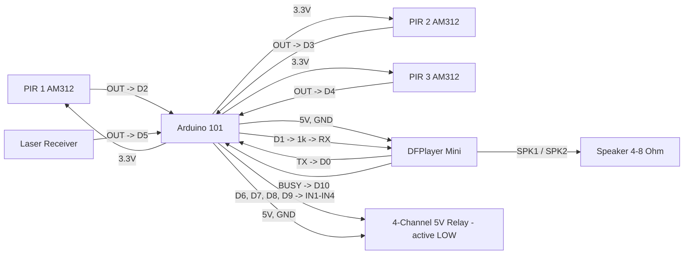

# Arduino 101 PIR / Laser Sound Trigger Pinout

**Created:** 2026-10-23
**Last Updated:** 2026-10-23

Target sketch:

- `components/arduino101/Arduino101_PIRLaserSoundTrigger/Arduino101_PIRLaserSoundTrigger.ino`

Up to three PIR motion sensors and one laser beam-break sensor each play their own sound on a DFPlayer Mini and pull their own negative trigger output LOW while that sound plays.

## Board Setup

- Board: Arduino/Genuino 101 (`Intel:arc32:arduino_101`); Arduino IDE 1.8.19 preferred
- Port: confirm in **Tools → Port** (Arduino 101 boards on the bench enumerate on different COM ports)
- Serial Monitor: `115200` baud
- Required library: DFRobotDFPlayerMini by DFRobot (install via Library Manager)
- CLI build: `tools/arduino/arduino.ps1 compile Arduino101_PIRLaserSoundTrigger`
- If Windows shows the board as a generic USB Serial Device, reinstall the Intel Curie board package drivers.
- If the upload stalls waiting for the device, press MASTER RESET as soon as the upload starts.
- Arduino 101 I/O runs at 3.3 V (inputs are 5 V tolerant).

## Function Map

| Function                | Arduino 101 pin   | Signal / behavior                           |
| ----------------------- | ----------------- | ------------------------------------------- |
| PIR 1 input             | D2                | HIGH on motion; plays track 1               |
| PIR 2 input             | D3                | HIGH on motion; plays track 2               |
| PIR 3 input             | D4                | HIGH on motion; plays track 3               |
| Laser sensor input      | D5                | HIGH when beam is broken; plays track 4     |
| PIR 1 trigger output    | D6                | Idle open (high-Z); LOW while track 1 plays |
| PIR 2 trigger output    | D7                | Idle open (high-Z); LOW while track 2 plays |
| PIR 3 trigger output    | D8                | Idle open (high-Z); LOW while track 3 plays |
| Laser trigger output    | D9                | Idle open (high-Z); LOW while track 4 plays |
| DFPlayer TX -> board RX | D0 (Serial1 RX)   | DFPlayer serial data in to the board        |
| Board TX -> DFPlayer RX | D1 (Serial1 TX)   | Through a 1 kOhm series resistor            |
| DFPlayer BUSY           | D10               | LOW while a track is playing                |
| Playing status LED      | D13 (onboard LED) | On while any sound is playing               |

**Why D0/D1 instead of pins 10/11:** the DFRobot UNO/Nano wiring uses SoftwareSerial on pins 10/11. The Arduino 101 has a spare hardware UART (`Serial1`) on D0/D1 that is separate from the USB serial port, which is more reliable. The Arduino 101 uploads over native USB, so the DFPlayer can stay connected to D0/D1 during uploads.

## Serial Output Path

- All messages print on **USB Serial** (`Serial`) through the USB connector; the DFPlayer uses `Serial1` on D0/D1.
- Open the Serial Monitor on the board's COM port at `115200` baud.
- Expected messages:
  - At startup: `Arduino 101 PIR/laser sound trigger ready`, followed by one line per sensor showing its input, output, and track
  - Every 5 seconds: `Heartbeat: DFPlayer ready, idle` (or `playing <sensor>`)
  - On a trigger: `PIR 1 triggered: output D6 LOW, playing track 1`
  - When the sound ends: `PIR 1 released: sound finished`
  - While another sound plays: `PIR 2 ignored: PIR 1 sound still playing`
  - During cooldown: `PIR 1 ignored: cooldown, 9 s left`

## Power and Ground

| Device             | Arduino 101 connection                     |
| ------------------ | ------------------------------------------ |
| DFPlayer VCC       | 5V                                         |
| AM312 PIR VCC (x3) | 3.3V                                       |
| Laser receiver VCC | 3.3V or 5V (match module spec)             |
| Relay module VCC   | 5V pin (one module) or external 5 V supply |
| All grounds        | Common GND with Arduino 101                |

**Power budget:** the DFPlayer draws its speaker current from the 5V rail, up to several hundred mA at high volume. Power the board from a solid 5 V USB supply or the barrel jack. If you use a 4-channel relay module, power its VCC from a separate regulated 5 V supply and connect its ground to the Arduino 101 GND.

## Board Power Input (Onboard Connector)

| Input Path        | Connector Available | Minimum Input            | Maximum Input             | Notes                                                                        |
| ----------------- | ------------------- | ------------------------ | ------------------------- | ---------------------------------------------------------------------------- |
| USB power         | Yes (USB)           | 4.75V                    | 5.25V                     | Preferred for bench setup and programming.                                   |
| Barrel jack / VIN | Yes                 | 7V (recommended minimum) | 12V (recommended maximum) | Board family limit is wider, but 7V to 12V is the practical operating range. |

## Wiring

| Arduino 101 pin | Connect to                      | Notes                           |
| --------------- | ------------------------------- | ------------------------------- |
| D0              | DFPlayer TX (pin 3)             | Hardware Serial1 RX             |
| D1              | 1 kOhm -> DFPlayer RX (pin 2)   | Hardware Serial1 TX             |
| D10             | DFPlayer BUSY (pin 16)          | Required to detect end of sound |
| 5V              | DFPlayer VCC (pin 1)            | DFPlayer runs from 5 V          |
| GND             | DFPlayer GND (pin 7 or 10)      | Common ground                   |
| D2              | PIR 1 OUT                       | AM312: HIGH on motion           |
| D3              | PIR 2 OUT                       | AM312: HIGH on motion           |
| D4              | PIR 3 OUT                       | AM312: HIGH on motion           |
| D5              | Laser receiver OUT              | HIGH when beam is broken        |
| 3.3V            | AM312 VCC (all three)           | AM312 is a 3.3 V sensor         |
| D6              | Relay 1 IN                      | Active LOW; released when idle  |
| D7              | Relay 2 IN                      | Active LOW; released when idle  |
| D8              | Relay 3 IN                      | Active LOW; released when idle  |
| D9              | Relay 4 IN                      | Active LOW; released when idle  |
| 5V              | Relay module VCC                | 5 V relay coil supply           |
| GND             | Sensor, relay, and DFPlayer GND | Grounds must be common          |

Connect the speaker (4 Ω or 8 Ω, up to 3 W) across DFPlayer **SPK1 (pin 6)** and **SPK2 (pin 8)**. Do not connect either speaker wire to GND.

```text
Arduino 101                               DFPlayer Mini
5V -------------------------------------> VCC (pin 1)
GND ------------------------------------> GND (pin 7)
D0 (RX) <-------------------------------- TX (pin 3)
D1 (TX) --------------------------------> 1 kOhm -> RX (pin 2)
D10 <------------------------------------ BUSY (pin 16)
                                          SPK1 / SPK2 (pins 6, 8) -> speaker

Arduino 101                               Sensors
3.3V -----------------------------------> VCC of PIR 1, 2, 3
D2 <------------------------------------- PIR 1 OUT
D3 <------------------------------------- PIR 2 OUT
D4 <------------------------------------- PIR 3 OUT
D5 <------------------------------------- Laser receiver OUT
GND ------------------------------------> GND of all sensors

Arduino 101                               5 V relay modules (active LOW)
D6 -------------------------------------> Relay 1 IN (PIR 1)
D7 -------------------------------------> Relay 2 IN (PIR 2)
D8 -------------------------------------> Relay 3 IN (PIR 3)
D9 -------------------------------------> Relay 4 IN (laser)
5V -------------------------------------> VCC
GND ------------------------------------> GND
```

## Example Layout Wiring Diagram



### Signal Summary

- D2-D4: PIR inputs. Each fires when its output rises HIGH (motion starts).
- D5: laser input. Fires when its output rises HIGH (beam broken).
- D6-D9: negative trigger outputs, one per sensor. Released (high-impedance) when idle; LOW while that sensor's sound plays.
- D0/D1: DFPlayer serial link (`Serial1`, 9600 baud).
- D10: DFPlayer BUSY. The sketch watches it to know when a sound has finished.
- D13: onboard LED, on while any sound is playing.

## SD Card Layout

Format the microSD card as FAT32 (32 GB or smaller). Create a folder named `mp3` in the root and name the files with a 4-digit track number:

| Sensor | Track number | SD card file  |
| ------ | ------------ | ------------- |
| PIR 1  | 1            | /mp3/0001.mp3 |
| PIR 2  | 2            | /mp3/0002.mp3 |
| PIR 3  | 3            | /mp3/0003.mp3 |
| Laser  | 4            | /mp3/0004.mp3 |

Text after the 4 digits is allowed (for example `0001_scream.mp3`). To use different track numbers, change `SENSOR_TRACKS` in the sketch.

## Trigger Logic

- **Edge triggered:** a sensor fires once when it *becomes* active. A sensor that stays active (a PIR still seeing motion, or a beam that stays blocked) does not re-fire until it goes inactive and trips again.
- **One sound at a time:** when a sensor fires, its output goes LOW and its track starts. Until that track finishes, every other trigger is **ignored, not queued**.
- **Output follows the sound:** the sensor's output stays LOW for the whole track and is released when the DFPlayer's BUSY pin reports the track has finished.
- **15-second cooldown per sensor:** a sensor can't fire again until 15 seconds after it last fired. Each sensor has its own cooldown; one sensor's cooldown never blocks another sensor. A trigger that is ignored because another sound is playing does not start a cooldown.
- **Startup warm-up:** triggers are ignored for the first 10 seconds while the sensors settle. AM312 PIRs can give false triggers right after power-up.
- **Safety limits:** if BUSY never goes LOW within 1.5 seconds of a trigger (no sound started), the output is released and an error is printed. Any sound is stopped and released after 3 minutes.

## Relay Logic

- The sketch is configured for **active LOW** 5 V relay modules.
- `LOW` on D6-D9 energizes the matching relay. When idle, each output is released instead of driven HIGH, because a 3.3 V HIGH may not fully switch off a 5 V active-LOW module. The module holds IN at 5 V, so the relays stay off, including during reset and boot. This is safe because the Arduino 101 pins are 5 V tolerant.
- **Do not add pull-downs on D6-D9;** they would switch the relays on. If a module's IN pin floats when disconnected, add a 10 kOhm pull-up from IN to 5V instead.

## Sketch Settings

| Setting               | Default            | Meaning                                                            |
| --------------------- | ------------------ | ------------------------------------------------------------------ |
| `SENSOR_ENABLED`      | all `true`         | Set unused sensors to `false` so a floating input can't trigger    |
| `SENSOR_ACTIVE_LEVEL` | all `HIGH`         | Set a sensor to `LOW` if its module pulls LOW when active          |
| `SENSOR_TRACKS`       | `1, 2, 3, 4`       | Track number played for each sensor                                |
| `COOLDOWN_MS`         | `15000`            | Per-sensor cooldown between triggers                               |
| `DFPLAYER_VOLUME`     | `25`               | DFPlayer volume, 0-30                                              |
| `SENSOR_WARMUP_MS`    | `10000`            | Triggers ignored after power-up                                    |
| `MAX_SOUND_MS`        | `180000`           | Longest a sound may play before it is stopped                      |

## Required Components and Resistor Guidance

- 1x Arduino/Genuino 101
- 1x DFPlayer Mini MP3 module + microSD card (FAT32)
- 1x speaker, 4 Ω or 8 Ω, up to 3 W
- Up to 3x AM312 mini PIR motion sensors
- 1x laser emitter + laser receiver module (output HIGH when the beam is broken)
- 1x 4-channel 5 V active-LOW relay module (or individual modules)
- 1x 1 kOhm resistor in series with the DFPlayer RX line
- Optional 1x 100 uF capacitor across DFPlayer VCC/GND to prevent pops and resets
- Optional 10 kOhm pull-ups from relay IN to 5V, only if a module's IN pin floats
- Jumper wires and a common ground

### Wiring notes for safe signal conditioning

1. Keep the DFPlayer serial and BUSY wires short and away from the relay and speaker wiring.
2. Connect D6-D9 directly to the relay modules' IN pins, with no pull-downs.
3. Use relay modules with their own transistor drivers and flyback diodes. Never wire a bare relay coil to a GPIO.
4. If a sensor isn't connected, set it to `false` in `SENSOR_ENABLED` or tie its input pin to GND.
5. Keep the sensors, DFPlayer, relay modules, and any external supply on a common ground.

## Operation

- No blocking delays or sleep calls are used; all timing uses `millis()`.
- A serial heartbeat every 5 seconds reports whether the DFPlayer responded at startup and what is playing.

## Troubleshooting

| Symptom                                    | Likely cause / what to check                                           |
| ------------------------------------------ | ---------------------------------------------------------------------- |
| Startup says DFPlayer did not respond      | D0/D1 swapped, missing 1 kOhm, no 5V/GND, or no SD card                |
| Trigger fires, then "no playback detected" | BUSY not wired to D10, missing /mp3 folder, or wrong file names        |
| Sensor fires but nothing happens           | Another sound is playing, or that sensor is still in its 15 s cooldown |
| Random triggers with nothing in front      | Unused sensor input left floating: disable it in SENSOR_ENABLED        |
| Laser fires constantly                     | Beam misaligned, or module is LOW-on-break: flip SENSOR_ACTIVE_LEVEL   |
| Relay stays on after the sound             | Pull-down on the output pin, or module is not active LOW               |
| Loud pop or DFPlayer resets on play        | Weak 5 V supply: add 100 uF across DFPlayer VCC/GND                    |

## Validation

1. Copy the four MP3 files to `/mp3/` on the SD card and insert it in the DFPlayer.
2. Select **Arduino/Genuino 101** and the board's port, then upload. If the upload stalls, press MASTER RESET as soon as the upload starts.
3. Open the Serial Monitor at `115200` and press RESET. Confirm the startup banner, one line per sensor, and `Heartbeat: DFPlayer ready, idle`.
4. Wait 10 seconds for the warm-up, then trip PIR 1. Confirm track 1 plays, relay 1 turns on for the whole sound, and `PIR 1 released: sound finished` prints when it ends.
5. While track 1 is playing, trip PIR 2. Confirm `PIR 2 ignored: PIR 1 sound still playing` and that track 1 keeps playing.
6. After track 1 ends, trip PIR 1 again within 15 seconds of its first trigger. Confirm `PIR 1 ignored: cooldown`.
7. Break the laser beam. Confirm track 4 plays and relay 4 turns on for the whole sound.
8. Power-cycle the board. Confirm no relay clicks on during boot.
