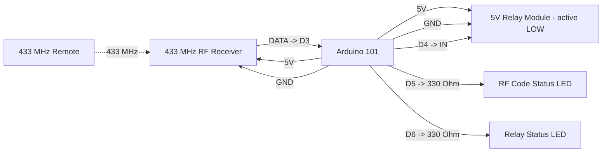

# Arduino 101 RF Code 0x0 Negative Trigger Pinout

**Created:** 2026-10-20
**Last Updated:** 2026-10-20

Target sketch:

- `components/arduino101/Arduino101_SimpleIRNegativeTriggerCode0x0/Arduino101_SimpleIRNegativeTriggerCode0x0.ino`

A 433 MHz RF receiver on D3 decodes remote codes and prints every code to the serial port. Only code `0x0` pulls the negative trigger output (relay) LOW for 500 ms.

> The folder name contains "IR" because it started as a copy of the IR sketch. This version uses a **433 MHz RF** receiver, not an IR receiver.

## Board Setup

- Board: Arduino/Genuino 101 (`Intel:arc32:arduino_101`); Arduino IDE 1.8.19 or arduino-cli
- Port: confirm with `.\tools\arduino\arduino.ps1 ports` (the bench unit enumerates as COM6; other units differ)
- Serial Monitor: `115200` baud
- No external libraries. See [Why D3 does not use rc-switch](#why-d3-does-not-use-rc-switch).
- Windows 11: if uploads hang at `Waiting for device...`, install the WinUSB DFU driver with Zadig (see `SETUP_GUIDE.md` Step 4).
- If the upload stalls waiting for the device, press MASTER RESET as soon as the upload starts.
- Arduino 101 I/O runs at 3.3 V (inputs are 5 V tolerant).

## Function Map

| Function                | Arduino 101 pin | Signal / behavior                                          |
| ----------------------- | --------------- | ---------------------------------------------------------- |
| RF receiver data        | D3              | Demodulated 433 MHz data from the receiver module          |
| Negative trigger output | D4              | Idle open (high-Z); LOW for 500 ms after code `0x0`        |
| RF code status LED      | D5              | On for 150 ms after each decoded frame (any code)          |
| Relay status LED        | D6              | On while the relay is switched on                          |
| RF receiver power       | 5V              | Most 433 MHz receivers need 5 V; check the module spec     |
| Common ground           | GND             | Shared by board, receiver, relay, and LEDs                 |

## Serial Output Path

- All messages print on **USB Serial** (`Serial`) through the USB connector; no GPIO pin carries serial text.
- Open the Serial Monitor on the board's COM port at `115200` baud.
- Expected messages:
  - At startup: `Arduino 101 RF code negative trigger ready`
  - `Trigger code: 0x0 -> negative trigger LOW for 500 ms`
  - `RF decoder: polling D3, rc-switch protocols 1-12, min 12 bits, 2 matching frames per press`
  - Every 5 seconds: `Heartbeat: RF input D3, negative trigger output D4, trigger code 0x0, codes received 0`
  - Each button press, trigger code: `RF code 0x0 (0) | 24 bits | protocol 1 | pulse 350 us -> TRIGGER: negative trigger LOW for 500 ms`
  - Each button press, other codes: `RF code 0x5A5A5A (5921370) | 24 bits | protocol 1 | pulse 352 us -> ignored (trigger code is 0x0)`

The value, bit count, and protocol match what rc-switch reports (for example, in `Arduino101_Node`), so you can reuse codes read here in the other RF sketches.

## Power and Ground

| Device                  | Arduino 101 connection                     |
| ----------------------- | ------------------------------------------ |
| RF receiver VCC         | 5V (or 3.3V if the module supports it)     |
| RF receiver GND         | GND                                        |
| Relay module VCC        | 5V pin (one module) or external 5 V supply |
| Relay module GND        | Common GND with Arduino 101                |
| External 5 V supply GND | Common GND with Arduino 101                |

**Relay power:** The board's 5V pin can power one small relay module. For several relays, use a separate regulated 5 V supply and connect its ground to the Arduino 101 GND.

## Board Power Input (Onboard Connector)

| Input Path        | Connector Available | Minimum Input            | Maximum Input             | Notes                                                                        |
| ----------------- | ------------------- | ------------------------ | ------------------------- | ---------------------------------------------------------------------------- |
| USB power         | Yes (USB)           | 4.75V                    | 5.25V                     | Preferred for bench setup and programming.                                   |
| Barrel jack / VIN | Yes                 | 7V (recommended minimum) | 12V (recommended maximum) | Board family limit is wider, but 7V to 12V is the practical operating range. |

## Wiring

| Arduino 101 pin | Connect to                     | Notes                                          |
| --------------- | ------------------------------ | ---------------------------------------------- |
| D3              | RF receiver DATA               | Either DATA pin if the module has two          |
| 5V              | RF receiver VCC                | 5 V output into D3 is safe (5 V tolerant)      |
| D4              | Relay module IN                | Active LOW; released when idle                 |
| 5V              | Relay module VCC               | 5 V relay coil supply                          |
| D5              | 330 Ohm -> RF LED anode        | LED cathode to GND                             |
| D6              | 330 Ohm -> relay LED anode     | LED cathode to GND                             |
| GND             | Receiver, relay, and LED GND   | Grounds must be common                         |

```text
Arduino 101                               433 MHz RF receiver
5V -------------------------------------> VCC
D3 <------------------------------------- DATA
GND ------------------------------------> GND
                                          ANT -> 17.3 cm straight wire (quarter wave)

Arduino 101                               5 V relay module (active LOW)
D4 -------------------------------------> IN
5V -------------------------------------> VCC
GND ------------------------------------> GND

Arduino 101                               Status LEDs
D5 -------------------------------------> 330 Ohm -> RF LED (+) ; LED (-) -> GND
D6 -------------------------------------> 330 Ohm -> relay LED (+) ; LED (-) -> GND
```

## Example Layout Wiring Diagram



### Signal Summary

- D3: RF receiver data, polled continuously and decoded with the rc-switch protocol rules.
- D4: negative trigger output. Released (high-impedance) when idle; LOW for 500 ms after a confirmed `0x0` code.
- D5: RF code status LED. Flashes for each decoded frame of any code, so it shows that the receiver and decoder are working.
- D6: relay status LED. On whenever D4 is switching the relay on.

## Code Decoding and Trigger Logic

- The decoder supports rc-switch protocols 1-12, which cover most fixed-code 433 MHz remotes (EV1527, PT2262, HT12E, and similar).
- **Noise filtering:** decodes shorter than 12 bits are ignored. A code must decode identically on 2 frames within 300 ms before it is printed or acted on. Remotes repeat each frame many times per press, so this costs nothing on a real press.
- **One print per press:** holding a button prints the code once. The same code counts as a new press after it has been absent for 300 ms.
- **Trigger:** only a confirmed code equal to `TRIGGER_CODE` (`0x0`) pulls D4 LOW for `TRIGGER_PULSE_MS` (500 ms). A new press during the pulse restarts the 500 ms timer.
- **All other codes** are printed with `-> ignored`, so you can identify the codes each remote button sends.
- To trigger on a different code, set `TRIGGER_CODE` to the value printed on the serial port, for example `0x5A5A5A`.
- Tuning constants: `MIN_CODE_BITS`, `CONFIRM_COUNT` (set to `1` if a remote sends very short bursts), and `CODE_RELEASE_MS`.

### Why D3 does not use rc-switch

rc-switch needs an interrupt on both signal edges (`CHANGE`). On the Arduino 101, D3 is an ARC (sensor subsystem) GPIO, and the Curie core silently turns `CHANGE` into falling-edge only on those pins. rc-switch would see only half the edges and never decode. `CHANGE` works only on SoC GPIO pins: D2, D4, D7, D8, D10, D11, D12, and D13.

This sketch polls D3 instead, using the same protocol table and decode rules as rc-switch, so the code values match. A difference from rc-switch: it can report code `0`. rc-switch treats 0 as "nothing received", which is why `Arduino101_Node` can never see `0x0`.

## Relay Logic

- The sketch is configured for an **active LOW** 5 V relay module.
- `LOW` on D4 energizes the relay. When idle, D4 is released instead of driven HIGH, because a 3.3 V HIGH may not fully switch off a 5 V active-LOW module. The module holds IN at 5 V, so the relay stays off, including during reset and boot. This is safe because the Arduino 101 pins are 5 V tolerant.
- **Do not add a pull-down on D4;** it would switch the relay on. If your module's IN pin floats when disconnected, add a 10 kOhm pull-up from IN to 5V instead.

## Required Components and Resistor Guidance

- 1x Arduino/Genuino 101
- 1x 433 MHz RF receiver module (superheterodyne RXB6 or similar recommended; XY-MK-5V superregenerative works at shorter range)
- 1x 433 MHz fixed-code remote or transmitter
- 1x 17.3 cm wire antenna for the receiver
- 1x 5 V active-LOW relay module (one channel)
- 2x LEDs and 2x 330 Ohm resistors for the status LEDs (about 4 mA each at 3.3 V)
- Optional 1x 10 kOhm pull-up from relay IN to 5V, only if the module's IN pin floats
- Jumper wires and a common ground

### Wiring notes for safe signal conditioning

1. Connect D4 directly to the relay module's IN pin, with no pull-down on D4.
2. Use a relay module with its own transistor driver and flyback diode. Never wire a bare relay coil to a GPIO.
3. Keep the receiver away from the relay coil and its wiring. Relay switching noise can block reception for a moment.
4. Keep the RF receiver, relay module, and any external 5 V supply on a common ground.

## Status LED Troubleshooting

| RF LED       | Relay LED     | Relay  | Likely cause / what to check                                                          |
| ------------ | ------------- | ------ | ------------------------------------------------------------------------------------- |
| Off          | Off           | Off    | Nothing decoded: check receiver 5V/GND, DATA -> D3, antenna, remote battery and band  |
| Flashes      | Off           | Off    | Codes decoded but not `0x0`: read the code on serial, then set `TRIGGER_CODE`         |
| Flashes      | On ~0.5 s     | Off    | Sketch triggered: check D4 -> IN, relay 5V/GND, active LOW module                     |
| Off          | Off           | On     | IN held LOW: remove any pull-down on D4; confirm active LOW module                    |
| Flashes      | On ~0.5 s     | Clicks | Working normally                                                                      |

If the RF LED never flashes, the remote may use a rolling-code or other protocol that rc-switch does not support.

## Validation

1. Upload: `.\tools\arduino\arduino.ps1 upload Arduino101_SimpleIRNegativeTriggerCode0x0 -Port COMx`. If the upload stalls, press MASTER RESET as soon as the upload starts.
2. Open the Serial Monitor at `115200` and press RESET. Confirm the startup banner and a heartbeat every 5 seconds.
3. With no remote pressed, confirm no `RF code` lines appear and the relay stays off.
4. Press each remote button once. Confirm one `RF code 0x...` line per press, and that the RF LED flashes.
5. Press the button that sends `0x0`. Confirm `-> TRIGGER`, and that the relay LED and relay turn on for about 0.5 seconds.
6. Press other buttons. Confirm `-> ignored (trigger code is 0x0)` and that the relay stays off.
7. Hold a button. Confirm the code prints once, not repeatedly.
8. Power-cycle the board. Confirm the relay does not click on during boot.
