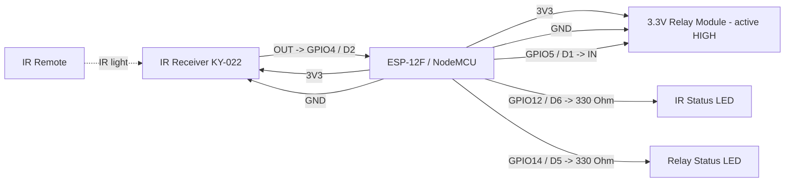

# ESP-12F Simple IR Positive Trigger Pinout

**Created:** 2026-10-19
**Last Updated:** 2026-10-19

Target sketch:

- `components/esp8266/ESP12F_SimpleIRPositiveTrigger/ESP12F_SimpleIRPositiveTrigger.ino`

## Board Setup

- Arduino board target: `NodeMCU 1.0 (ESP-12E Module)` (`esp8266:esp8266:nodemcuv2`)
- Port: COM8 on the bench setup (CP210x USB-serial adapter). Confirm in **Tools → Port**.
- If Windows shows an unknown or generic USB device, install the CP210x or CH340 driver that matches the board's USB-serial chip.
- Serial Monitor: `115200` baud
- Required library: IRremote by Arduino-IRremote
- ESP8266 GPIO is 3.3 V only. Do not connect 5 V signals to GPIO.

## Function Map

| Function                | ESP-12F GPIO | NodeMCU-style label | Signal / behavior                             |
| ----------------------- | ------------ | ------------------- | --------------------------------------------- |
| IR receiver signal      | GPIO4        | D2                  | Receives decoded IR signals                   |
| Positive trigger output | GPIO5        | D1                  | Idle LOW; 3.3 V HIGH for 500 ms per IR signal |
| IR status LED           | GPIO12       | D6                  | On for 100 ms after any IR activity           |
| Relay status LED        | GPIO14       | D5                  | On while the relay is switched on             |
| IR receiver power       | 3V3          | 3V3                 | Power the receiver from 3.3 V                 |
| Common ground           | GND          | GND                 | Shared by board, receiver, relay, and LEDs    |

On a bare ESP-12F module, connect to the GPIO numbers. D1 and D2 labels apply only to NodeMCU-style development boards.

## Serial Output Path

- All messages print on **USB Serial** (`Serial`) through the USB-serial adapter; no GPIO pin carries serial text.
- Open the Serial Monitor on the board's COM port at `115200` baud. A few garbled characters right after reset are the ESP8266 boot ROM (74880 baud) and are normal.
- Expected messages:
  - At startup: `ESP-12F simple IR positive trigger ready`
  - After the banner: `Status LEDs: IR GPIO12, relay GPIO14`
  - Every 5 seconds: `Heartbeat: IR input GPIO4, positive trigger output GPIO5`
  - On each decoded IR signal: `IR signal received; positive trigger HIGH for 500 ms`

## Power and Ground

| Device           | ESP-12F / NodeMCU connection |
| ---------------- | ---------------------------- |
| IR receiver VCC  | 3V3                          |
| IR receiver GND  | GND                          |
| Relay module VCC | 3V3                          |
| Relay module GND | Common GND with ESP-12F      |

The relay coil draws its current from the 3V3 rail, so the 3.3 V supply must cover the ESP8266's Wi-Fi peaks (about 300 mA) plus the relay coil. The regulator on a NodeMCU-style board normally handles one small relay module; a bare ESP-12F needs a 3.3 V supply sized for both.

## Board Power Input

| Input Path             | Connector Available      | Minimum Input | Maximum Input | Notes                                                          |
| ---------------------- | ------------------------ | ------------- | ------------- | -------------------------------------------------------------- |
| USB power (NodeMCU)    | Micro-USB on dev boards  | 4.75V         | 5.25V         | Preferred for programming and serial monitoring.               |
| VIN / 5V pin (NodeMCU) | Header pin on dev boards | 4.8V          | 5.5V          | Use regulated 5 V unless the board vendor specifies otherwise. |
| 3V3 (bare ESP-12F)     | Module 3V3 pad           | 3.0V          | 3.6V          | Size the supply for Wi-Fi peaks plus the relay coil.           |

## Wiring

| ESP-12F / NodeMCU pin | Connect to                     | Notes                              |
| --------------------- | ------------------------------ | ---------------------------------- |
| GPIO4 / D2            | IR receiver OUT/S              | IR data input                      |
| 3V3                   | IR receiver VCC                | Do not power the receiver from 5 V |
| 3V3                   | Relay module VCC               | 3.3 V relay coil supply            |
| GPIO5 / D1            | Relay module IN                | Active HIGH at 3.3 V; idle LOW     |
| GPIO12 / D6           | 330 Ohm -> IR status LED anode | LED cathode to GND                 |
| GPIO14 / D5           | 330 Ohm -> relay LED anode     | LED cathode to GND                 |
| GND                   | Receiver, relay, and LED GND   | Grounds must be common             |

```text
ESP-12F / NodeMCU                         IR receiver
3V3 ------------------------------------> VCC
GPIO4 (D2) <----------------------------- OUT / S
GND ------------------------------------> GND

ESP-12F / NodeMCU                         3.3 V relay module
3V3 ------------------------------------> VCC
GPIO5 (D1) -----------------------------> IN
GND ------------------------------------> GND

ESP-12F / NodeMCU                         Status LEDs
GPIO12 (D6) ----------------------------> 330 Ohm -> IR LED (+) ; LED (-) -> GND
GPIO14 (D5) ----------------------------> 330 Ohm -> relay LED (+) ; LED (-) -> GND
```

## Example Layout Wiring Diagram



### Signal Summary

- GPIO4 (D2): IR receiver input, decoded by IRremote.
- GPIO5 (D1): positive trigger output. Idle LOW; HIGH for 500 ms after each decoded IR signal.
- GPIO12 (D6): IR status LED. On for 100 ms after any LOW on GPIO4, decoded or not.
- GPIO14 (D5): relay status LED. On whenever GPIO5 is switching the relay on.

## Relay Logic

- The sketch is configured for an **active HIGH** 3.3 V relay module.
- `HIGH` on GPIO5 energizes the relay; GPIO5 is driven LOW when idle.
- The polarity is fixed in the sketch; there is no `RELAY_ACTIVE_LOW` setting. For a 5 V negative-trigger relay, use the negative-trigger pattern from the Arduino 101 simple sketch.
- GPIO4, GPIO5, GPIO12, and GPIO14 are not boot-strapping pins, so the receiver, relay, and LED wiring do not affect boot. Avoid GPIO0, GPIO2, and GPIO15 for these signals.
- The output is pulse-based: each decoded IR signal restarts the 500 ms timer.

## Required Components and Resistor Guidance

- 1x ESP-12F module or NodeMCU-style ESP-12F development board
- 1x KY-022 (TL1838/VS1838B) IR receiver module
- 1x IR remote transmitter
- 1x 3.3 V active-HIGH relay module (one channel)
- 1x regulated 3.3 V supply sized for Wi-Fi peaks plus the relay coil (bare ESP-12F only)
- Optional 1x 10 kOhm pull-down from GPIO5 to GND if the relay clicks at power-up
- 2x LEDs and 2x 330 Ohm resistors for the status LEDs (about 4 mA each at 3.3 V)
- Jumper wires and a common ground

### Wiring notes for safe signal conditioning

1. Connect GPIO5 directly to the relay module's IN pin. The module must recognize 3.3 V as HIGH.
2. Use a relay module with its own transistor driver and flyback diode. Never wire a bare relay coil to a GPIO.
3. GPIO5 floats briefly at power-up, before the sketch drives it LOW. If the relay clicks during boot, add the 10 kOhm pull-down.
4. Keep the IR receiver, relay module, and ESP-12F on a common ground.

## Operation

- Any IR frame decoded by IRremote starts or restarts a 500 ms active-HIGH output pulse.
- The output returns LOW after 500 ms without blocking delays or sleep calls.
- The IR status LED lights for 100 ms after any receiver activity. The relay status LED follows the relay output.
- A serial heartbeat prints the IR input and output GPIO numbers every 5 seconds.

## Status LED Troubleshooting

When the relay doesn't trigger, the two status LEDs show where the chain breaks: IR receiver, IR decoding, or relay. The IR LED shows raw receiver activity, so it can flash even when IRremote can't decode the signal.

| IR LED    | Relay LED  | Relay  | Likely cause / what to check                                           |
| --------- | ---------- | ------ | ---------------------------------------------------------------------- |
| Off       | Off        | Off    | No IR at receiver: check 3V3, GND, OUT -> GPIO4, remote battery        |
| Flashes   | Off        | Off    | IR seen but not decoded: try another remote or move closer             |
| Flashes   | On ~500 ms | Off    | Sketch triggered: check GPIO5 -> IN, relay 3V3/GND, active HIGH module |
| On steady | Off        | Off    | Receiver output stuck LOW: check receiver power, sunlight, IR lamps    |
| Off       | Off        | On     | IN held HIGH: remove any pull-up on GPIO5; confirm active HIGH module  |
| Flashes   | On ~500 ms | Clicks | Working normally                                                       |

## Validation

1. Select **NodeMCU 1.0 (ESP-12E Module)** and the board's port, then upload.
2. Open the Serial Monitor at `115200` and press RESET. Confirm the startup banner and a heartbeat every 5 seconds.
3. With no IR present, confirm the relay and both status LEDs are off.
4. Press any remote button at the receiver. Confirm `IR signal received; positive trigger HIGH for 500 ms`, that the IR LED flashes, and that the relay LED and relay turn on for about 500 ms. If not, use the status LED table above.
5. Power-cycle the board. Confirm the relay does not click on during boot; if it does, add the 10 kOhm pull-down on GPIO5.
