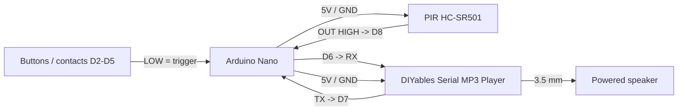

# Arduino Nano MP3 Trigger Player Pinout

**Created:** 2026-10-25
**Last Updated:** 2026-10-25

Target sketch:

- `components/nano/Nano_MP3TriggerPlayer/Nano_MP3TriggerPlayer.ino`

Each trigger input plays its own MP3 file **once** on a DIYables Serial MP3 Player module (YX5300 chip). While a file is
playing, **all other triggers are ignored** (not queued). Wiring follows the
[Arduino Nano - MP3 Player tutorial](https://newbiely.com/tutorials/arduino-nano/arduino-nano-mp3-player)
(module RX/TX on D6/D7).

## Board Setup

- Arduino board target: `Arduino Nano`, Processor **ATmega328P** (`arduino:avr:nano:cpu=atmega328`). Old-bootloader Nanos: pass `-Fqbn arduino:avr:nano:cpu=atmega328old`.
- Port: confirm with `.\tools\arduino\arduino.ps1 ports`. CH340 clones show as "USB-SERIAL CH340"; always pass `-Port`.
- Serial Monitor: `115200` baud
- No external libraries (uses the built-in `SoftwareSerial`; the module commands are sent directly).
- Close the Serial Monitor before uploading.

## Function Map

| Function              | Nano pin      | Signal / behavior                                                   | Plays            |
| --------------------- | ------------- | ------------------------------------------------------------------- | ---------------- |
| Negative trigger 1    | D2            | `INPUT_PULLUP`; fires on HIGH -> LOW (button/contact to GND)        | `01/001*.mp3`    |
| Negative trigger 2    | D3            | Same as D2                                                          | `01/002*.mp3`    |
| Negative trigger 3    | D4            | Same as D2                                                          | `01/003*.mp3`    |
| Negative trigger 4    | D5            | Same as D2                                                          | `01/004*.mp3`    |
| PIR input             | D8            | `INPUT`, active HIGH; fires on LOW -> HIGH                          | `01/005*.mp3`    |
| MP3 module RX         | D6 (Nano TX)  | SoftwareSerial 9600 baud                                            | -                |
| MP3 module TX         | D7 (Nano RX)  | SoftwareSerial 9600 baud                                            | -                |
| Playing LED           | D13 (onboard) | On while a file is playing                                          | -                |

Unused negative trigger pins can stay unwired: the internal pull-up holds them idle. To change pins, files, or add/remove
inputs, edit the `triggers[]` table at the top of the sketch.

## Trigger and Lockout Behavior

- **Negative triggers (D2-D5):** active LOW. Fire once per press on the HIGH -> LOW edge (30 ms debounce). Holding the input LOW does not repeat; it must return HIGH to re-arm.
- **PIR (D8):** active HIGH. Fires once on the LOW -> HIGH edge. An HC-SR501 holds its output HIGH while motion continues; the file still plays only once. The PIR must drop LOW before it can fire again.
- **PIR warm-up:** PIR edges are ignored for the first 30 s after power-up (`PIR_WARMUP_MS`).
- **Busy lockout:** while a file plays, every trigger edge is ignored and logged as `ignored (busy ...)`. Nothing is queued.
- **Post-play lockout:** 1 s after a file ends (`POST_PLAY_LOCKOUT_MS`).
- **Boot:** inputs already active at power-up (held button, PIR HIGH) must release before they can fire.

### End-of-file detection

The YX5300 has no BUSY pin, so the sketch uses its serial replies:

1. `0x3D` "track finished" message from the module (primary).
2. Status query (`0x42`) every 2 s after a 1.5 s grace period. A "stopped" reply ends playback (`STATUS_POLL_MS = 0` disables this).
3. `MAX_PLAY_MS` (5 min): safety unlock that also sends Stop. Raise it if any file is longer than 5 minutes.

A module error reply (`0x40`, for example file not found) also ends the lockout immediately.

## SD Card Layout

Format the micro SD card as FAT32. Create folder `01` and name each file with a 3-digit prefix:

```text
SD card root
└── 01
    ├── 001_trigger_d2.mp3
    ├── 002_trigger_d3.mp3
    ├── 003_trigger_d4.mp3
    ├── 004_trigger_d5.mp3
    └── 005_pir.mp3
```

Files are selected by folder number + file number, so copy order does not matter.

## Power and Ground

| Device              | Nano connection                 |
| ------------------- | ------------------------------- |
| MP3 module VCC      | 5V                              |
| MP3 module GND      | GND                             |
| PIR VCC             | 5V (HC-SR501 accepts 4.5-20 V)  |
| PIR GND             | GND                             |
| Buttons / contacts  | Between input pin and GND       |
| Powered speaker     | Own supply; 3.5 mm jack on module |

### Audio output to an external amplifier

The module's 3.5 mm jack is a stereo headphone-level output. It can feed an amplifier's **line-in / AUX** input directly.

- **Cable:** 3.5 mm stereo to 3.5 mm, or 3.5 mm to 2x RCA (L/R).
- **Level:** start with `MP3_VOLUME` at 20-25 and the amp gain low, then raise the amp gain. If the sound distorts, lower
  `MP3_VOLUME` instead. At 30 (maximum) the output can be hotter than a line input expects.
- **Hum/buzz:** a ground loop between the Nano's supply and the amp's supply can cause hum. Try another outlet or USB supply
  for the Nano. If that doesn't fix it, add an inline 3.5 mm ground-loop isolator.
- **Power-up pop:** the module may click at power-on. Turn the amp on after the Nano, or keep it turned down at power-up.
- **Do not** connect the jack to a **mic** input (it will distort) or to an amp's **speaker output** terminals.

## Wiring

| Nano pin | Connect to                       | Notes                                          |
| -------- | -------------------------------- | ---------------------------------------------- |
| D6       | MP3 module RX                    | Nano transmits commands                        |
| D7       | MP3 module TX                    | Nano receives status / track finished          |
| 5V       | MP3 module VCC                   |                                                |
| GND      | MP3 module GND                   |                                                |
| D2-D5    | Button / dry contact to GND      | Active LOW; internal pull-up                   |
| D8       | PIR OUT                          | Active HIGH                                    |
| 5V       | PIR VCC                          |                                                |
| GND      | PIR GND, button commons          | Grounds must be common                         |

```text
Arduino Nano                              DIYables Serial MP3 Player (YX5300)
D6 -------------------------------------> RX
D7 <------------------------------------- TX
5V -------------------------------------> VCC
GND ------------------------------------> GND
                                          3.5 mm jack -> powered speaker

Arduino Nano                              Trigger inputs
D2 ----[button / contact]---------------> GND   (plays 01/001)
D3 ----[button / contact]---------------> GND   (plays 01/002)
D4 ----[button / contact]---------------> GND   (plays 01/003)
D5 ----[button / contact]---------------> GND   (plays 01/004)

Arduino Nano                              PIR (HC-SR501)
5V -------------------------------------> VCC
D8 <------------------------------------- OUT   (plays 01/005)
GND ------------------------------------> GND
```

**External trigger sources:** to drive a negative trigger input from another controller's relay, wire the relay's COM/NO
contacts between the input pin and Nano GND. If driving it from another board's GPIO, connect the grounds and make sure
the other board pulls LOW for "trigger"; a 5 V board can drive it directly.

## Example Layout Wiring Diagram



## Serial Output

- At startup: `Arduino Nano MP3 trigger player ready`, then one line per input with its file.
- Trigger: `Trigger D2 -> PLAY 01/001 (other triggers locked out until it finishes)`
- During playback: `PIR D8 ignored (busy playing 01/001)`
- End: `Playback ended (track finished) after 7.4 s; triggers re-armed`
- Every 5 seconds: `Heartbeat: idle, inputs D2=idle D3=idle D4=idle D5=idle D8=idle, plays 0, ignored 0`

## Troubleshooting

| Symptom                                           | Likely cause / what to check                                                     |
| ------------------------------------------------- | -------------------------------------------------------------------------------- |
| `-> PLAY` printed, no sound                       | RX/TX swapped (D6 -> module RX), speaker power/volume, SD card FAT32             |
| `MP3 module error 0x..`                           | File missing: check folder `01` and the `001`-style file prefixes                |
| LED stays on long after the file ends             | No end message reaching D7: check module TX -> D7; unlocks at `MAX_PLAY_MS`      |
| Playback cut off / ends ~1.5-2 s in               | Module clone reports "stopped" while playing: set `STATUS_POLL_MS = 0`           |
| PIR fires at power-up or repeatedly               | Warm-up still running, or HC-SR501 in repeat-trigger (H) mode with low delay pot |
| Button press not detected                         | Button must connect the pin to **GND** (active LOW)                              |

## Validation

1. Compile: `.\tools\arduino\arduino.ps1 compile Nano_MP3TriggerPlayer`
2. Upload: `.\tools\arduino\arduino.ps1 upload Nano_MP3TriggerPlayer -Port COMx` (close the Serial Monitor first).
3. Open the Serial Monitor at `115200`. Confirm the startup banner and a heartbeat every 5 seconds.
4. Ground D2 briefly. Confirm `01/001` plays once and the D13 LED stays on until it ends.
5. While it plays, ground D3 and wave at the PIR. Confirm both log `ignored (busy ...)` and nothing plays afterward.
6. After `Playback ended`, wait for the PIR warm-up to pass, trigger the PIR, and confirm `01/005` plays once even while motion continues.

Compile verified 2026-10-25: 7,748 B flash (25%), 469 B RAM (22%). Not yet bench-tested with the module.
